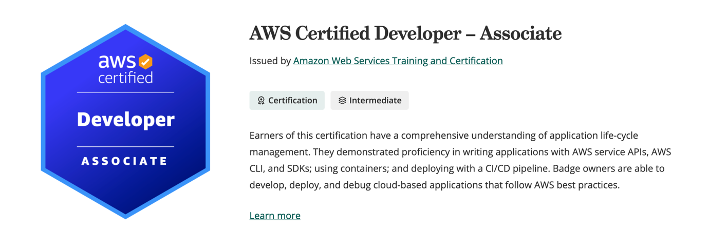

好像 20 多天没更新了，那几天准备考证来着。但是好在一遍就 pass 了。

教程看的：[Udemy: AWS Certified Developer Associate](https://www.udemy.com/course/aws-certified-developer-associate-dva-c01/)

顺手记的笔记放在下面了（似乎换个人根本看不懂）：

## 身份与权限

- 访问方式
  - ==CLI==：IAM User Access Key & Secret Key
  - ==Console==：username & passwd
- ==IAM Role==：λ 往外走的权限（我能做什么）
- ==Resource Policy==：别人往里进的权限（谁能调用我）
- ==Bucket Policy==：谁能访问桶。Principal 不能是 EC2 instance
- IAM Role 无法给 IAM Group
- ==IAM DB authentication==：No passwd，but IAM role tokens
- ==Leading Keys==：用户只能写入分区键等于自己 ID 的项目
- ==RAM==：资源 sharing

### Cognito

- ==User Pool==：登录认证，发 JWT token（ID token / access token），不发 AWS temp cred
- ==Identity Pool==：token 换 AWS temp credential，允许未认证用户

## Lambda

- `handler(event, context)`
  - event：data to be handled
  - context：info，i.e. request ID
- ==Container Image==：10GB
- ==λ@Edge== 只能 us-east-1
- 异步调用失败自动重试 2 次，on success / on failure 可以发到 SQS、SNS、EventBridge、λ、S3
- `aws lambda invoke`：to test things that are already on cloud
- 指标：==Invocation== 是次数，==Duration== 是时间
- 流量切分：λ → weighted，CodeDeploy → canary

## SAM / CDK / CloudFormation

| 命令 | 作用 |
|---|---|
| `sam init` | creates a new SAM project |
| `sam local invoke` | 用一个事件直接调用一次 func |
| `sam local generate-event` | 生成各种事件源的样例事件 |
| `sam local start-lambda` | 本地模拟 Lambda 的调用 |
| `sam local start-api` | 本地模拟 API Gateway |
| `cdk init` | a new CDK project |
| `cdk synth` | |
| `cdk bootstrap` | 在某个 Account + Region 中第一次使用 CDK 时 run |

- ==CloudFormation StackSets==：同一个 CloudFormation template deploy 到多个 AWS Account 及多个 Region 中
- ==Change Set==
- ==Drifts==
- CloudFormation 的 stack 有原生通知选项

## 部署

- ==CodeDeploy== is for：EC2、λ、ECS
- ==Beanstalk==：traffic splitting
- ==CodeArtifact==：Upstream Repo
- `aws ec2 run-instances`：新建
- `aws ec2 start-instances`：启动

## 容器：ECS

- ECS（Elastic Container Service）跑在
  - ==EC2==：num、patch、scale 自己管
  - ==Fargate==：只管 CPU、RAM
- ==Task Definition==：一个任务长什么样，container 的 env var 写在这
- ==Service Definition==：这些任务怎么长期运行管理

## 存储与数据库

### S3 / Glacier

| 存储类型 | 取回时间 |
|---|---|
| Glacier Instant Retrieval | instant (ms) |
| Glacier Flexible Retrieval | 加急 1-5 min / 标准 3-5h / 批量 5-12h |
| Glacier Deep Archive | 12-48h |

- Standard / One Zone ==IA==：不常 visit
- event noti 驱动 λ：S3 为 source，λ + trigger

### DynamoDB

- ==GetItem== / ==BatchGetItem==

### 缓存

- ==Memcached==：multi-threads / ez / horizontal
- ==Redis==：高可用、持久、backup、complex

### RDS

- ==Connection Pooling==：RDS Proxy

## 消息与事件

- ==SNS== 有 filter
- ==SQS==：12h
- ==EventBridge==：源 → filter → λ → Bridge
- ==Firehose== 内置 function：把 data 给 λ 处理

## API Gateway

- ==JWT== authorizer 只有 HTTP API 支持
- ==Integration Request==

## 监控与排错

- ==Embedded Metric Format (EMF)==：λ 只要按 EMF 格式输出日志，CloudWatch 就会自动从日志中提取 metric，写入日志中指定的 namespace，可以直接画图
- ==X-Ray==
  - ==Annotation==：KV pairs，index，可以用来搜
  - ==Metadata==：任意，不 index
  - annotation is from SDK
- ==CloudTrail== 记 SSE-KMS 的使用

## 加密与安全

- ==信封加密==（envelope encryption）
- ==SSE-KMS== 能 audit
- ==Secrets Manager== 原生复制 Replication
- ==Macie== is for S3

## 网络

- ==VPC Endpoint==：VPC 内 visit AWS service

## 测试

- ==unit test==：event
- ==integration test==：environment & AWS service

## HTTP 状态码

| 状态码 | 含义 |
|---|---|
| 401 Unauthorized | 未认证，无 credential |
| 403 Forbidden | 认证了 but 无 permission |
| 404 Not Found | 不存在资源 |
| 503 Service Unavailable | 服务不可用 |
| 505 Version Not Supported | HTTP 版本不支持 |
