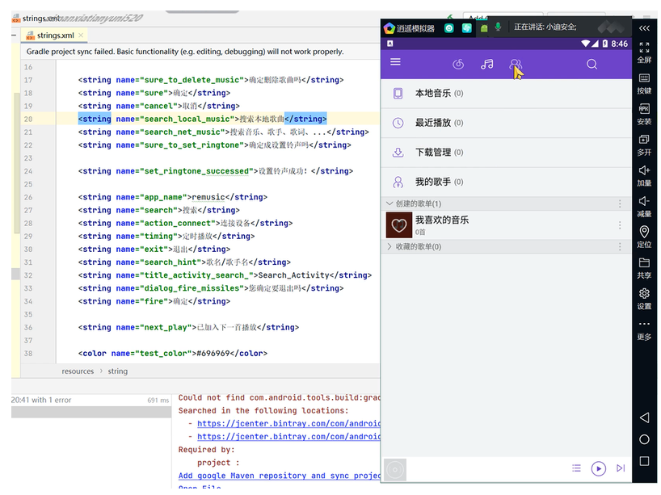

课程为小迪安全官方 2024 年上传，本文为个人学习笔记。Course published by XiaoDi Security in 2024. These are my personal study notes.

## APP 应用开发架构

> App 用什么方式开发，决定了它的数据怎么传、逻辑写在哪，也就决定了该用什么方法去测。先分清开发架构，才能选对思路，不至于把所有 App 都当成同一种东西。

##### 1、原生开发

> 原生 App 的很多逻辑写在客户端代码里，需要结合逆向和抓包来分析。了解原生开发的特点，才知道测试这类 App 要准备哪些技能。

**安卓一般使用java语言开发，当然现在也有Kotlin语言进行开发**。如何开发就涉及到具体编程了，这里就不详说了。简单描述就是使用安卓提供的一系列控件来实现页面，复杂点的页面可以通过自定义控件来实现。

##### 2、使用H5语言开发

> H5 页面本质上是网页，嵌在 App 里也一样会请求后端接口。认出 H5 开发的部分，就可以用熟悉的 Web 测试思路去处理。

**使用H5开发的好处有很多，可多端复用**，比如 浏览器 端，ios端，当然H5开发的体验是没有原生好的。结合我做过的项目来说，一般是这个页面需要分享出去的话，就用H5开发。

##### 3、使用flutter开发

> Flutter 跨平台 App 越来越常见，它的打包和运行方式和原生、H5 都不同，分析起来也有自己的特点。提前知道有这种架构，遇到时才不会无从下手。

flutter是近年来谷歌推出的一款UI框架，使用dart语言进行开发，支持跨平台，weight渲染直接操作硬件层，体验可媲美原生。**但是flutter技术比较新，生态还不完善，开发起来效率相对偏低。**

##### 4、常规Web开发

> 很多 App 只是给网站套了一层壳，核心还是网站本身。认出这一点，就能直接回到 Web 测试，省去不必要的逆向工作。

Web App软件开发简单地说，就是开发一个网站，然后加入app的壳。**Web App一般非常小，内容都是app内的网页展示，受制于网页技术本身，可实现功能少，而且每次打开，几乎所有的内容都需要重新加载，所以反应速度慢，内容加载过多就容易卡死，用户体验差，而且app内的交互设计等非常有效。但开发周期长端，需要的技术人员少，成本低。

## APP - 开发架构 - 原生态

> 原生 App 的安全问题常藏在客户端逻辑和它调用的接口里。理解这一点，才明白为什么测试原生 App 需要反编译和抓包，而不仅仅是看界面。

演示：remusic项目源码  
安全影响：反编译&抓包&常规测试  
**安全影响：逆向的角度去分析逻辑设计安全**

## APP-开发架构–Web封装-封装平台

> 封装平台生成的 App 和原网站没有本质区别，测试对象其实就是那个网站。分清这一点能避免在 App 外壳上浪费时间，直接把精力放在 Web 本身。

> 演示：ShopXO源码程序+一门APP打包(输入手机站网址或上传Html文件，三分钟在线生成APP)  
> 就是网站直接做成app
> 安全影响：常Web安全测试
 **使用平台将web网站封装成手机端APP，与单纯的web没有任何差异。**

## APP-开发架构-H5& Vue -HBuilderX

> H5 和 Vue 开发的 App 大量依赖 JS 和后端 API，问题多出在接口和前端逻辑上。了解这种架构，就知道测试重点应该放在 API 和 JS 代码上。

演示：HBuilderX案例  
**安全影响：API&JS框架安全问题&JS前端测试**

## WX小程序-开发架构-Web封装-平台

> 小程序是很多单位的重要业务入口，背后常和官网、App 共用一套后端接口。了解小程序的开发方式，信息收集和测试时才不会漏掉这块资产。

> 演示：ShopXO源码程序+一门APP打包  
> 安全影响：常规Web安全测试
> 
    演示：HBuilderX案例  
    安全影响：API&JS框架安全问题&JS前端测试
