<span class="post-note"><span class="i18n" data-lang="zh">课程为小迪安全官方 2024 年上传，本文为个人学习笔记。</span><span class="i18n" data-lang="en">Course published by XiaoDi Security in 2024. These are my personal study notes.</span></span>

**演示案例**

- 数据：方法、头部、状态码
- 案例：文件探针、登录爆破
- 工具：Postman 自构造使用

## 0. HTTP 请求

浏览器访问网站的流程：

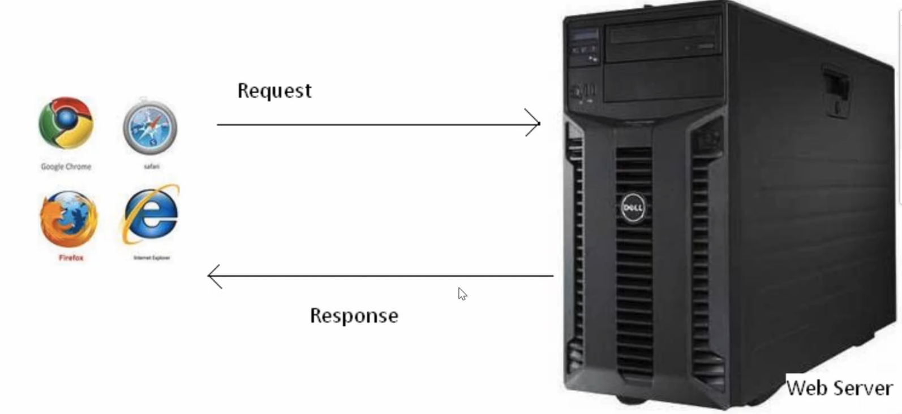

有代理时：

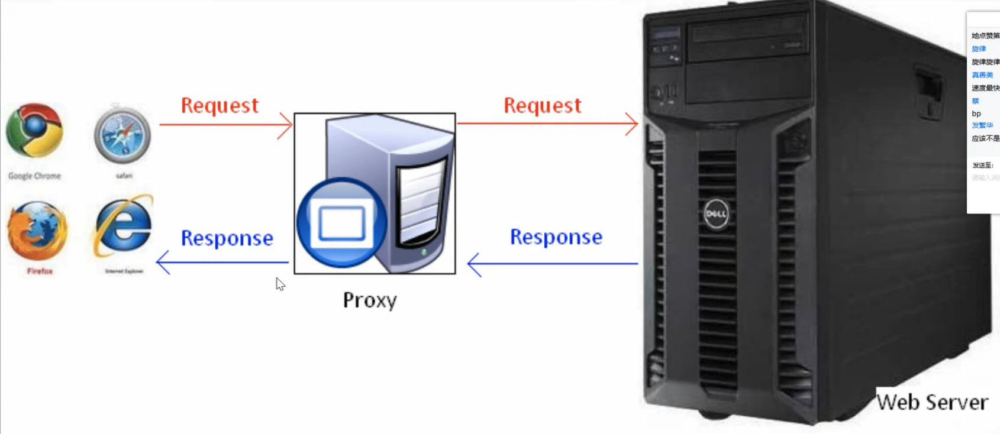

请求行的结构：**请求方式 + URL + HTTP 版本**。

### GET：没有正文

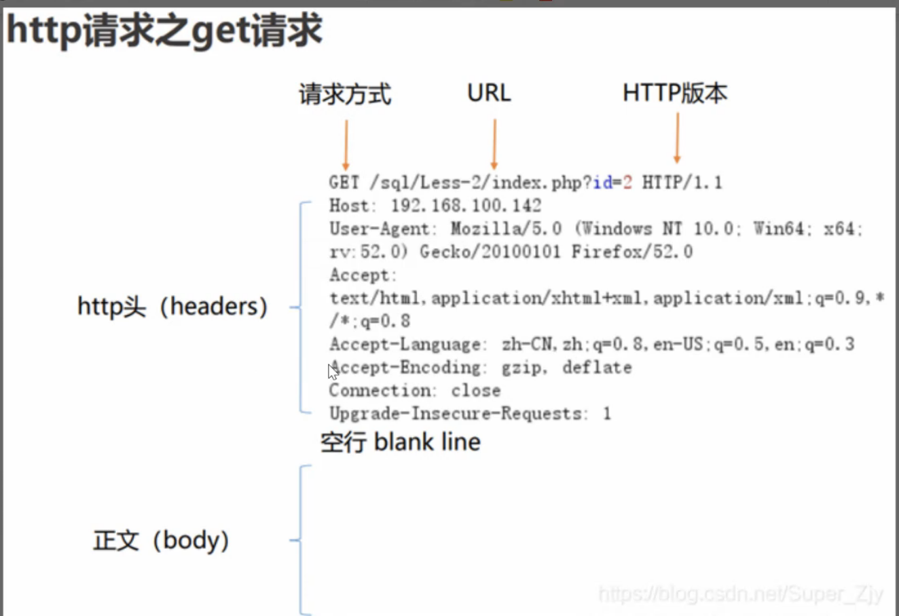

### POST：有正文（数据）

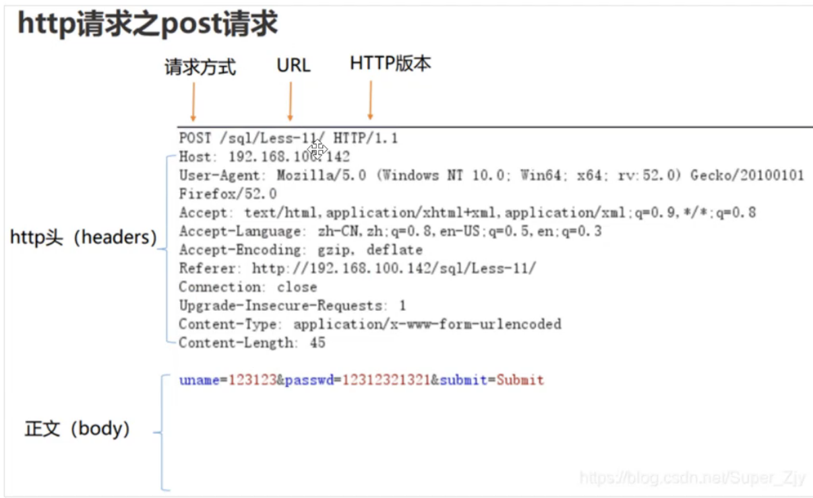

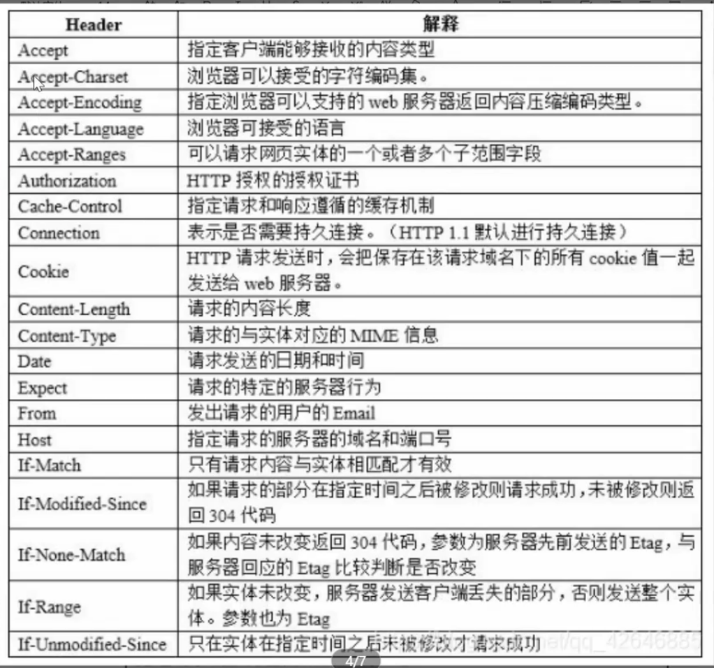

## 1. Burp Suite 抓包演示

**使用 Burp Suite 作为代理，在浏览器里设置代理：**

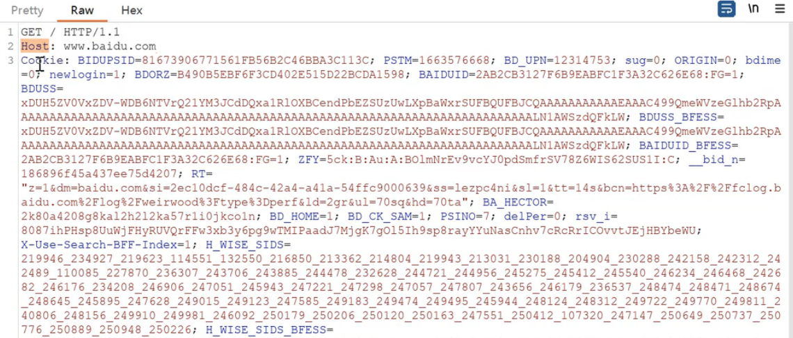

User-Agent 头：

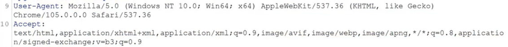

POST 请求会把数据放在正文里上传，这个登录包的正文就是 username 和 password：

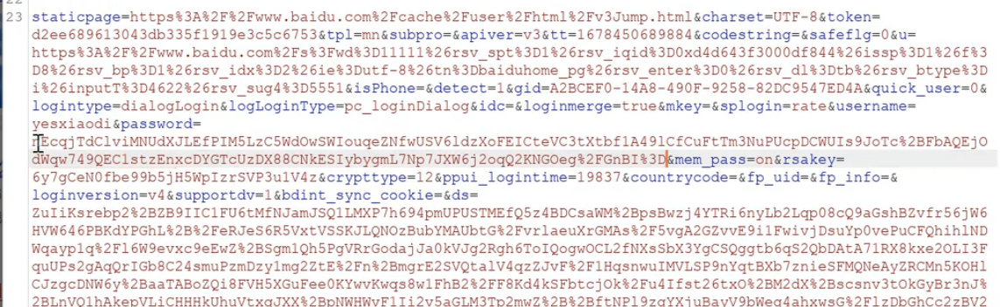

演示 2：

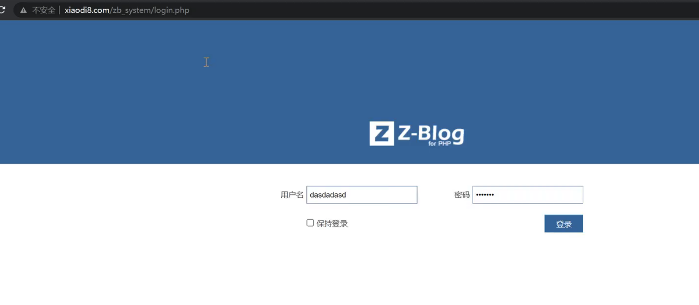

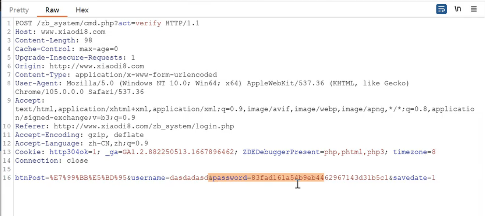

### UA 头：判断设备

包的内容和访问网站的平台（设备）有关。同样是访问百度，手机和电脑浏览器发出的包是不同的。

网站用 ==UA 头==判断访问者是什么设备。把手机包里的 UA 头复制到电脑的包里，用 Burp 修改后再发送，电脑上看到的就是手机版百度。

### Cookie：用户身份凭据

==Cookie== 是用户身份的凭据。如果把一个已经登录的网站的包保存下来，再发送一次就会直接处于登录状态。

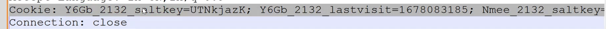

把 Cookie 写进去然后发送：

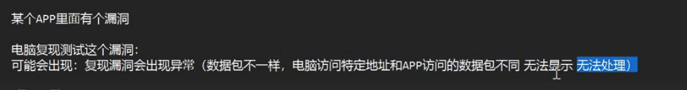

## 2. Response 状态码

状态码可以用来判断：

1. 数据是否正常
2. 文件是否存在
3. 地址是否自动跳转
4. 服务是否出错

注意：网站可能有容错处理，要识别出来，不能只看状态码。

### 分类

| 状态码 | 含义 |
|---|---|
| 1xx | 指示信息：请求已接收，继续处理 |
| 2xx | 成功：请求已被成功接收、理解、接受 |
| 3xx | 重定向：要完成请求必须进行进一步的操作 |
| 4xx | 客户端错误：请求有语法错误或请求无法实现 |
| 5xx | 服务器端错误：服务器未能实现合法的请求 |

### 常见状态码

| 状态码 | 含义 |
|---|---|
| 200 OK | 客户端请求成功 |
| 301 Moved Permanently | 页面永久性移走，服务器进行重定向跳转 |
| 302 Found | 页面暂时性移走，服务器进行重定向跳转，具有被劫持的安全风险 |
| 400 Bad Request | 客户端请求有语法错误，服务器无法理解 |
| 401 Unauthorized | 请求未经授权 |
| 403 Forbidden | 服务器收到请求，但是拒绝提供服务 |
| 404 Not Found | 请求的资源不存在，例如输入了错误的 URL |
| 500 Internal Server Error | 服务器发生不可预期的错误，无法完成请求 |
| 503 Service Unavailable | 服务器当前无法处理客户端的请求 |

code 200：

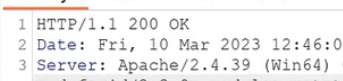

### 用状态码判断文件是否存在

| 状态码 | 判断 |
|---|---|
| 200 | 文件存在 |
| 404 | 文件不存在 |
| 403 | 文件夹存在 |
| 500 | 可能存在，也可能不存在 |
| 3xx | 可能存在，也可能不存在 |

例子：

```text
/zb_system/                  → 403  文件夹存在
/zb_system/admin/            → 200  等同于访问 /zb_system/admin/index.php
/zb_system/admin/index.php   → 200
```

访问文件夹时，服务器会自动指向文件夹里的默认首页。比如 `www.xiaodi8.com` 和 `www.xiaodi8.com/index.php` 是同一个页面。

3xx 要分两种情况：

1. 容错处理：网站访问出错时自动跳转到某个页面，说明**不存在**
2. 访问某个文件时触发跳转，说明**存在**

## 3. Burp Suite 演示

通过修改高亮处的路径来探测路径是否存在，看返回的状态码：

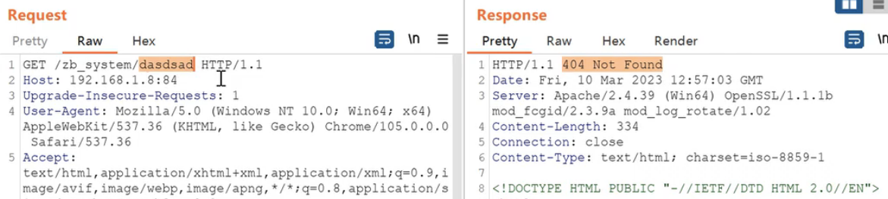

### Intruder 功能

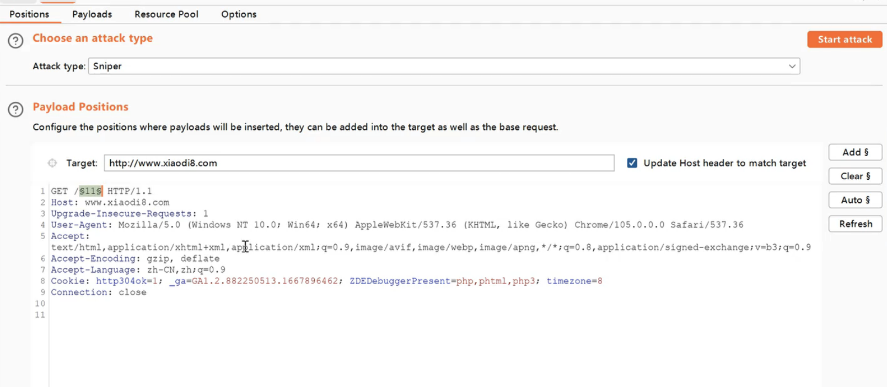

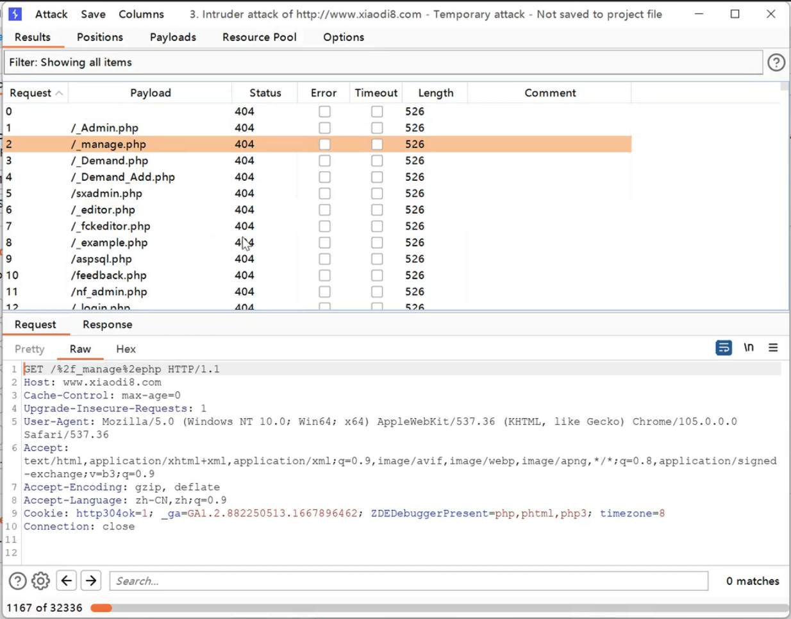

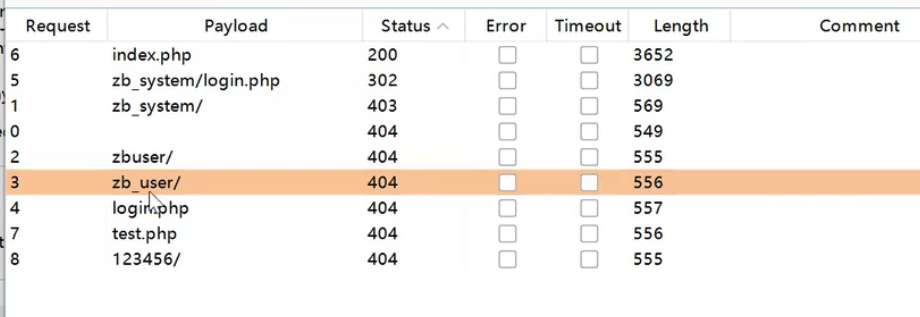

可以同时替换两个位置，比如位置 1 是用户名，位置 2 是密码：

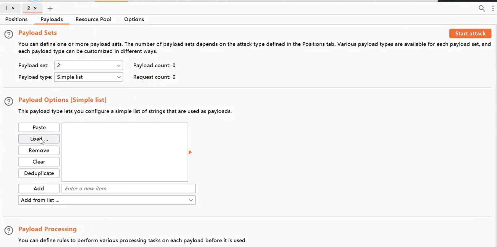

如果密码在提交前做了加密（hash），可以用 Payload Processing 自动把字典加密成对应的密文：

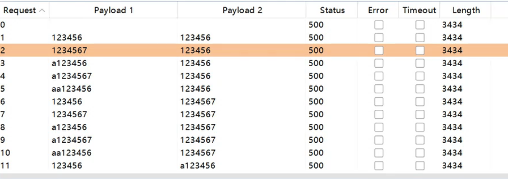

## 4. Postman 演示

略。
