<span class="post-note"><span class="i18n" data-lang="zh">课程为小迪安全官方 2024 年上传，本文为个人学习笔记。</span><span class="i18n" data-lang="en">Course published by XiaoDi Security in 2024. These are my personal study notes.</span></span>

**演示案例**

- 数据：方法、头部、状态码
- 案例：文件探针、登录爆破
- 工具：Postman 自构造使用

## 0. HTTP 请求

> Web 测试的对象就是一个个 HTTP 请求和响应，看懂请求的结构，才知道抓到的包里每一部分是什么、哪些地方可以修改测试。

浏览器访问网站的流程：

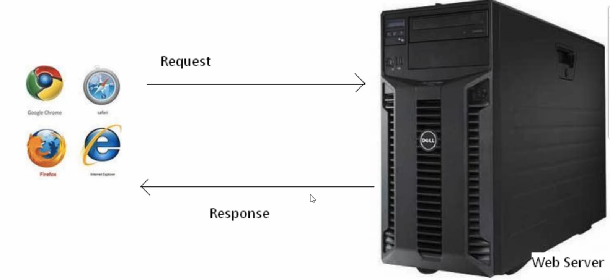

有代理时：

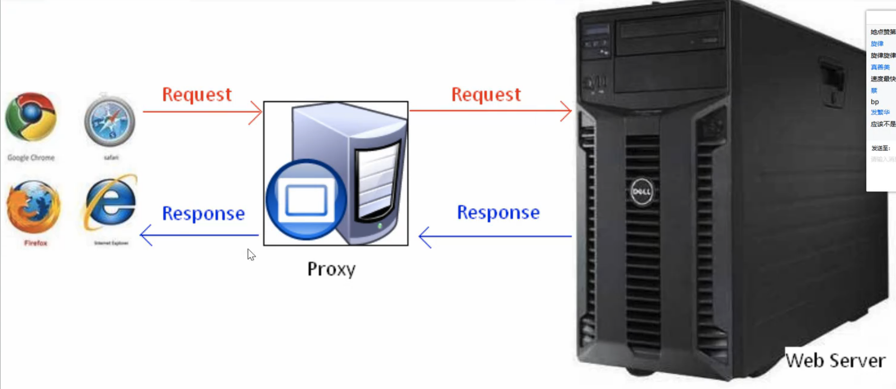

请求行的结构：**请求方式 + URL + HTTP 版本**。

### GET：没有正文

> GET 把参数放在 URL 里，会出现在浏览器历史和服务器日志中。分清参数放在哪里，测试时才知道该改哪一部分。

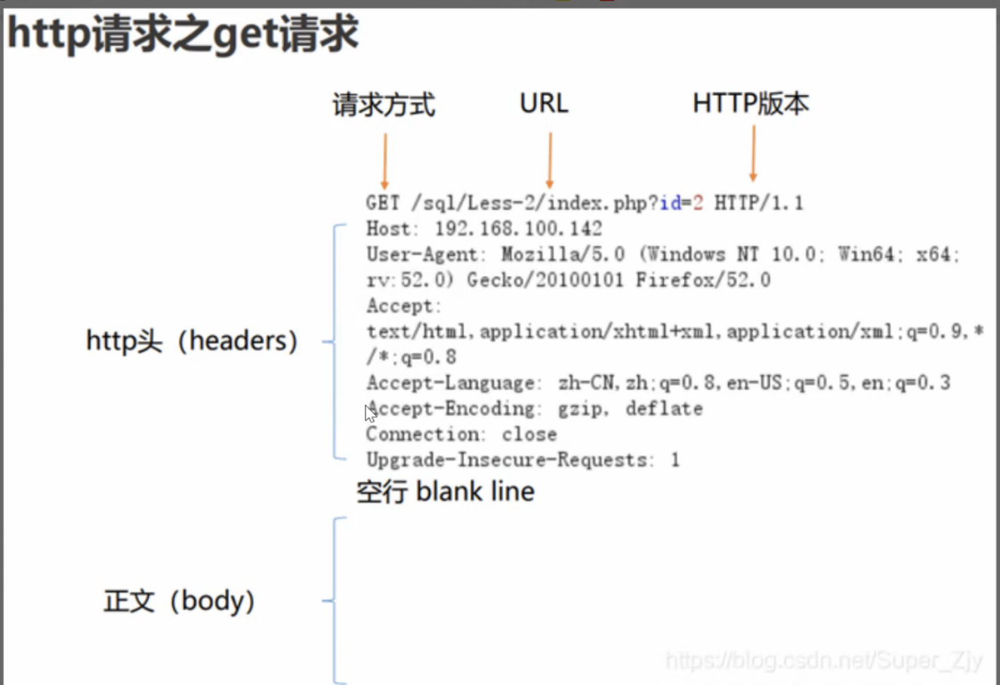

### POST：有正文（数据）

> 登录、提交表单、上传文件一般用 POST，数据在正文里，地址栏看不到，只有抓包才能看见和修改。

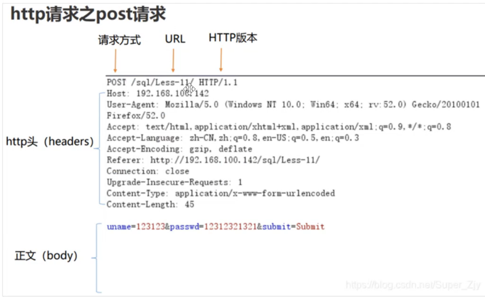

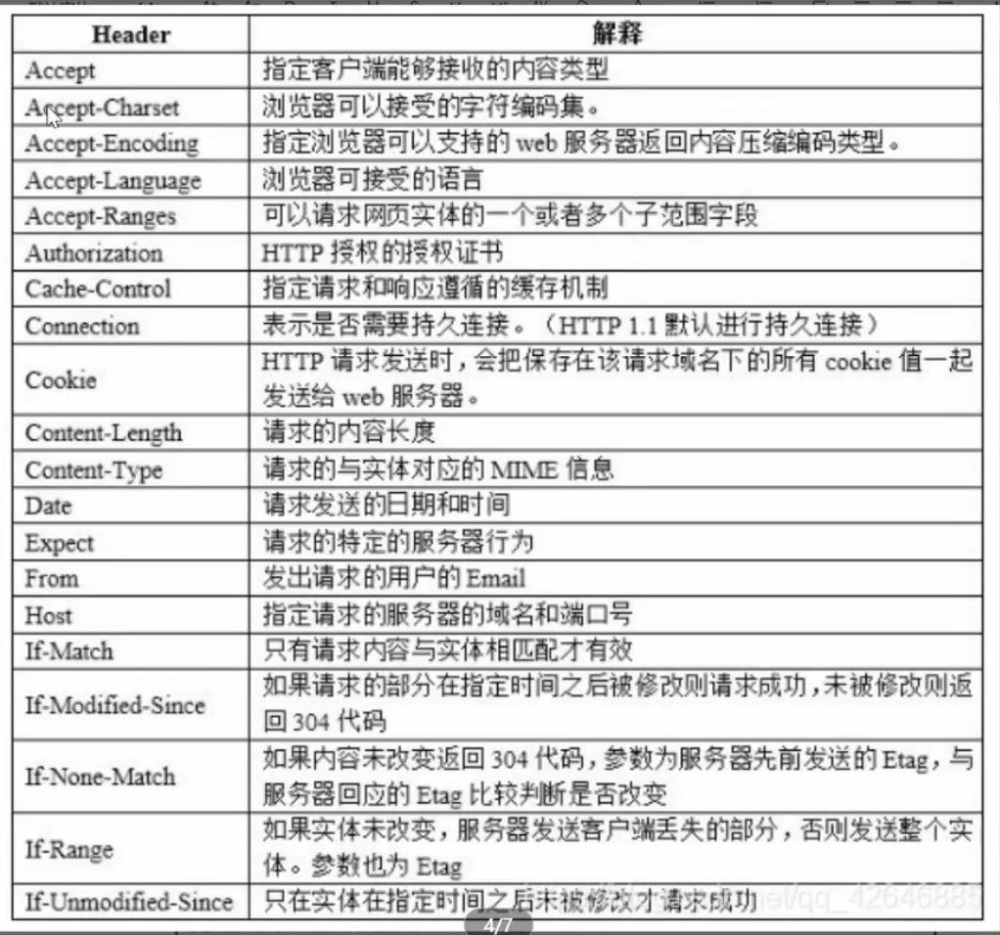

## 1. Burp Suite 抓包演示

> 通过真实的包看请求头和正文，把前面的概念和实际看到的数据对应起来，以后分析数据包心里就有底了。

**使用 Burp Suite 作为代理，在浏览器里设置代理：**

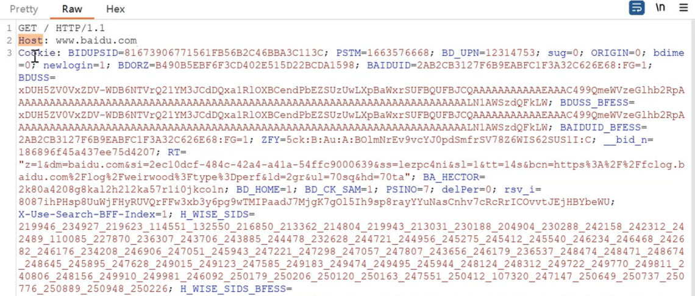

User-Agent 头：

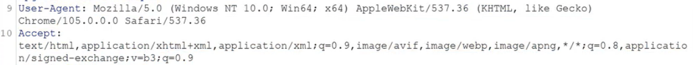

POST 请求会把数据放在正文里上传，这个登录包的正文就是 username 和 password：

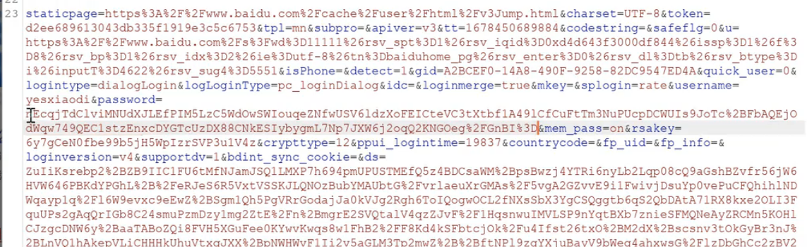

演示 2：

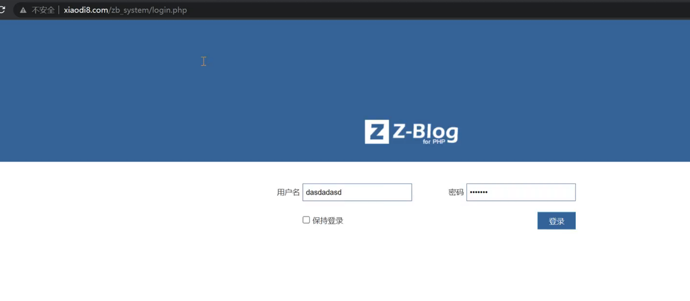

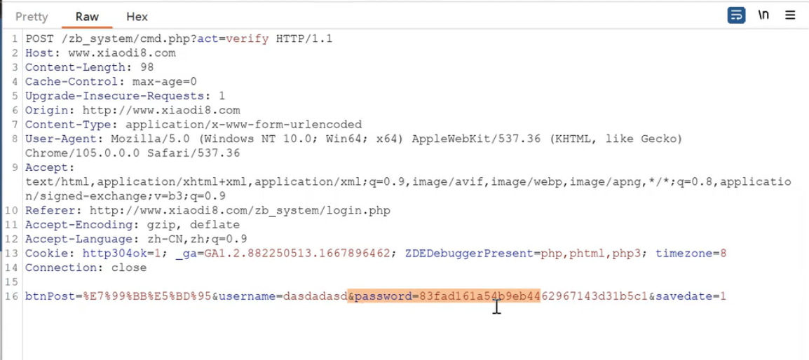

### UA 头：判断设备

> 网站会根据 UA 返回不同的页面，手机版和电脑版有时是两套代码，防护也可能不一样。会改 UA，就能测到平时在电脑上看不到的那一版。

包的内容和访问网站的平台（设备）有关。同样是访问百度，手机和电脑浏览器发出的包是不同的。

网站用 ==UA 头==判断访问者是什么设备。把手机包里的 UA 头复制到电脑的包里，用 Burp 修改后再发送，电脑上看到的就是手机版百度。

### Cookie：用户身份凭据

> Cookie 代表登录状态，谁拿到它就能以这个用户的身份访问。理解这一点，才明白 Cookie 泄露为什么危害大，这也是测试越权问题的基础。

==Cookie== 是用户身份的凭据。如果把一个已经登录的网站的包保存下来，再发送一次就会直接处于登录状态。

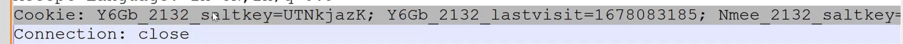

把 Cookie 写进去然后发送：

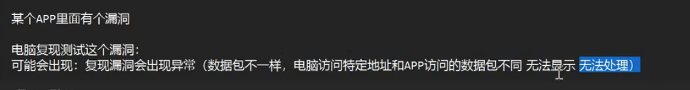

## 2. Response 状态码

> 状态码是服务器对请求最直接的反馈，批量测试时不可能一个个去看页面，靠状态码就能快速判断结果。

状态码可以用来判断：

1. 数据是否正常
2. 文件是否存在
3. 地址是否自动跳转
4. 服务是否出错

注意：网站可能有容错处理，要识别出来，不能只看状态码。

### 分类

> 记住五大类的含义，看到陌生的状态码也能大致判断是成功、跳转还是出错。

| 状态码 | 含义 |
|---|---|
| 1xx | 指示信息：请求已接收，继续处理 |
| 2xx | 成功：请求已被成功接收、理解、接受 |
| 3xx | 重定向：要完成请求必须进行进一步的操作 |
| 4xx | 客户端错误：请求有语法错误或请求无法实现 |
| 5xx | 服务器端错误：服务器未能实现合法的请求 |

### 常见状态码

> 这几个状态码在测试中出现得最频繁，熟悉它们能快速判断请求有没有被拒绝、资源在不在、服务器有没有报错。

| 状态码 | 含义 |
|---|---|
| 200 OK | 客户端请求成功 |
| 301 Moved Permanently | 页面永久性移走，服务器进行重定向跳转 |
| 302 Found | 页面暂时性移走，服务器进行重定向跳转，具有被劫持的安全风险 |
| 400 Bad Request | 客户端请求有语法错误，服务器无法理解 |
| 401 Unauthorized | 请求未经授权 |
| 403 Forbidden | 服务器收到请求，但是拒绝提供服务 |
| 404 Not Found | 请求的资源不存在，例如输入了错误的 URL |
| 500 Internal Server Error | 服务器发生不可预期的错误，无法完成请求 |
| 503 Service Unavailable | 服务器当前无法处理客户端的请求 |

code 200：

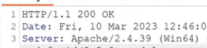

### 用状态码判断文件是否存在

> 目录和文件探测就是靠状态码判断结果，能帮助发现遗留的后台、备份文件等敏感资源。同时要留意网站的容错跳转，避免误判。

| 状态码 | 判断 |
|---|---|
| 200 | 文件存在 |
| 404 | 文件不存在 |
| 403 | 文件夹存在 |
| 500 | 可能存在，也可能不存在 |
| 3xx | 可能存在，也可能不存在 |

例子：

```text
/zb_system/                  → 403  文件夹存在
/zb_system/admin/            → 200  等同于访问 /zb_system/admin/index.php
/zb_system/admin/index.php   → 200
```

访问文件夹时，服务器会自动指向文件夹里的默认首页。比如 `www.xiaodi8.com` 和 `www.xiaodi8.com/index.php` 是同一个页面。

3xx 要分两种情况：

1. 容错处理：网站访问出错时自动跳转到某个页面，说明**不存在**
2. 访问某个文件时触发跳转，说明**存在**

## 3. Burp Suite 演示

> 先手动改路径看状态码，理解探测的原理，后面用工具批量跑时才知道结果该怎么看。

通过修改高亮处的路径来探测路径是否存在，看返回的状态码：

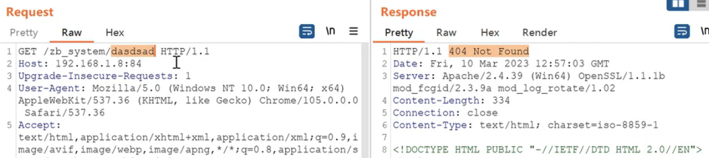

### Intruder 功能

> Intruder 能把一个请求按字典批量修改后发送，是测试弱口令、批量探测的常用模块。理解它，也就明白登录接口为什么需要限制尝试次数和加验证码。

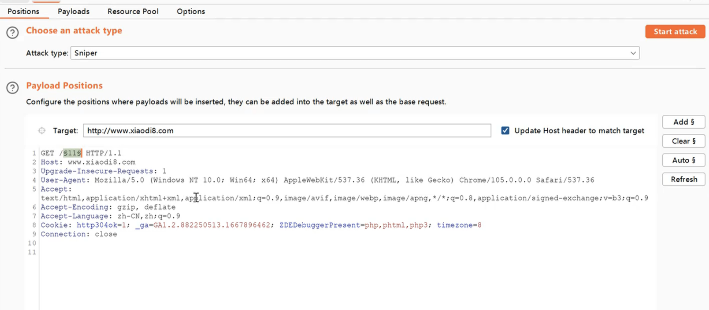

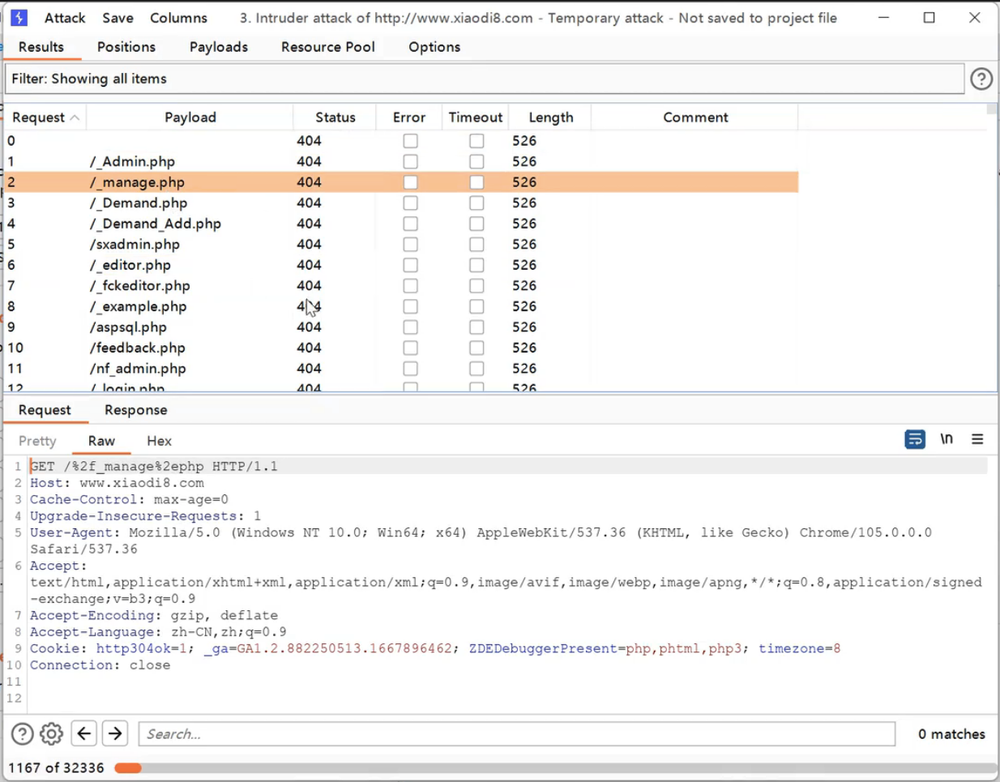

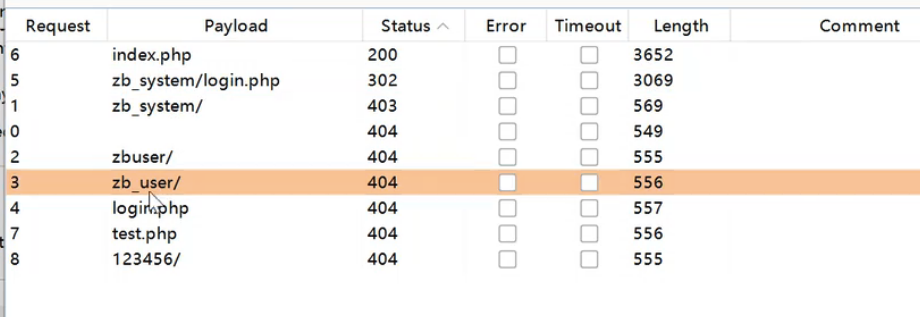

可以同时替换两个位置，比如位置 1 是用户名，位置 2 是密码：

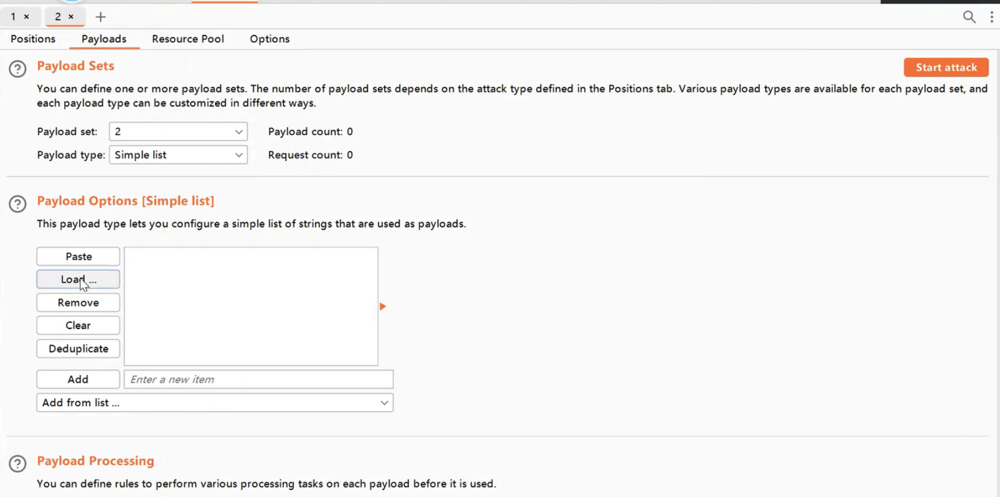

如果密码在提交前做了加密（hash），可以用 Payload Processing 自动把字典加密成对应的密文：

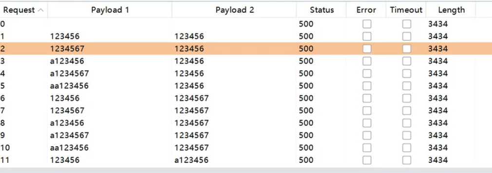

## 4. Postman 演示

> Postman 不依赖浏览器就能直接构造任意请求，调试和测试接口很方便，尤其适合没有前端页面的 API。

略。
