<span class="post-note"><span class="i18n" data-lang="zh">课程为小迪安全官方 2024 年上传，本文为个人学习笔记。</span><span class="i18n" data-lang="en">Course published by XiaoDi Security in 2024. These are my personal study notes.</span></span>

**演示案例**

- 应用：信息打点，某某企业
- Web：信息打点，教育 SRC（Security Response Center，安全应急响应中心）
- Web：信息打点，补天 SRC

## 0. 知识点总览

### 业务资产：应用类型分类

一个单位对外提供了哪些类型的互联网产品。常见分类：

- **Web 网站**：官网、商城、管理后台
- **手机 App**：Android、iOS 应用
- **PC 客户端**：Windows、macOS 软件
- **小程序**：微信、支付宝小程序
- **公众号**：微信公众号、服务号
- **API 服务**：给其他程序调用的接口

### Web 单域名获取：接口查询

针对一个已知域名，通过第三方平台或公开数据接口查询相关信息。

例如查询 `example.com`，可能获得：域名注册信息、ICP 备案信息、DNS 解析记录、当前或历史 IP、HTTPS 证书记录、所属企业信息、同一 IP 上的其他域名。

### Web 子域名获取：解析枚举

寻找主域名下可能存在的子域名。

假设主域名是 `example.com`，可能存在 `www.example.com`、`mail.example.com`、`api.example.com`、`shop.example.com`。

解析枚举通常是准备一个常见前缀的列表（比如 mail、api、shop），拼成完整的域名，然后查询 DNS。能正常解析，说明这个子域名很可能存在。

### Web 架构资产：平台指纹识别

通过网站公开返回的信息，判断它使用了哪些技术或平台。可能识别出：

- Web 服务器：Nginx、Apache、IIS
- 开发语言：PHP、Java、Python、ASP.NET
- CMS：WordPress、Z-Blog、DedeCMS
- 开发框架：Laravel、Spring、Django、ThinkPHP
- 前端框架：Vue、React
- 操作系统或云平台
- CDN、WAF 等防护服务

识别依据可能包括 HTTP 响应头、Cookie 名称、网页源码、特定文件和页面特征。它通常只是概率判断，网站也可能隐藏或伪装这些特征。

## 1. 资源整理

各个工具的讲解在后面的章节里。

### 企业与备案信息

| 标签 | 名称 | 地址 |
|---|---|---|
| 企业信息 | 天眼查 | [https://www.tianyancha.com/](https://www.tianyancha.com/) |
| 企业信息 | 小蓝本 | [https://www.xiaolanben.com/](https://www.xiaolanben.com/) |
| 企业信息 | 爱企查 | [https://aiqicha.baidu.com/](https://aiqicha.baidu.com/) |
| 企业信息 | 企查查 | [https://www.qcc.com/](https://www.qcc.com/) |
| 企业信息 | 国外企查 | [https://opencorporates.com/](https://opencorporates.com/) |
| 企业信息 | 启信宝 | [https://www.qixin.com/](https://www.qixin.com/) |
| 备案信息 | 备案信息查询 | [http://www.beianx.cn/](http://www.beianx.cn/) |
| 备案信息 | 备案管理系统 | [https://beian.miit.gov.cn/](https://beian.miit.gov.cn/) |
| 公众号信息 | 搜狗微信搜索 | [https://weixin.sogou.com/](https://weixin.sogou.com/) |
| 注册域名 | 域名注册查询 | [https://buy.cloud.tencent.com/domain](https://buy.cloud.tencent.com/domain) |
| IP 反查 | IP 反查域名 | [https://x.threatbook.cn/](https://x.threatbook.cn/) |
| IP 反查 | IP 反查域名 | [http://dns.bugscaner.com/](http://dns.bugscaner.com/) |

**IP 反查**：已知一个服务器的 IP 地址，查询有哪些域名曾经或正在指向这个 IP。正常的 DNS 查询方向是「域名 → IP」（`example.com → 1.2.3.4`），反查则反过来，用来判断同一服务器上托管了哪些网站。

### 子域名与 DNS

| 标签 | 名称 | 地址 |
|---|---|---|
| DNS 数据 | DNSDumpster | [https://dnsdumpster.com/](https://dnsdumpster.com/) |
| 证书查询 | Certificate Search | [https://crt.sh/](https://crt.sh/) |
| 网络空间 | FOFA | [https://fofa.info/](https://fofa.info/) |
| 网络空间 | 全球鹰（Hunter） | [http://hunter.qianxin.com/](http://hunter.qianxin.com/) |
| 网络空间 | 360 Quake | [https://quake.360.cn/quake/#/index](https://quake.360.cn/quake/#/index) |
| 威胁情报 | 微步在线情报社区 | [https://x.threatbook.cn/](https://x.threatbook.cn/) |
| 威胁情报 | 奇安信威胁情报中心 | [https://ti.qianxin.com/](https://ti.qianxin.com/) |
| 威胁情报 | 360 威胁情报中心 | [https://ti.360.cn/#/homepage](https://ti.360.cn/#/homepage) |
| 枚举解析 | 在线子域名查询 | [http://tools.bugscaner.com/subdomain/](http://tools.bugscaner.com/subdomain/) |
| 枚举解析 | DNSGrep 子域名查询 | [https://www.dnsgrep.cn/subdomain](https://www.dnsgrep.cn/subdomain) |
| 枚举解析 | OneForAll 子域名收集器 | [https://github.com/shmilylty/OneForAll](https://github.com/shmilylty/OneForAll) |

### 指纹识别

| 标签 | 名称 | 地址 |
|---|---|---|
| 指纹识别 | 在线 CMS 指纹识别 | [http://whatweb.bugscaner.com/look/](http://whatweb.bugscaner.com/look/) |
| 指纹识别 | Wappalyzer | [https://github.com/AliasIO/wappalyzer](https://github.com/AliasIO/wappalyzer) |
| 指纹识别 | TideFinger 潮汐 | [http://finger.tidesec.net/](http://finger.tidesec.net/) |
| 指纹识别 | 云悉指纹 | [https://www.yunsee.cn/](https://www.yunsee.cn/) |
| 指纹识别 | WhatWeb | [https://github.com/urbanadventurer/WhatWeb](https://github.com/urbanadventurer/WhatWeb) |
| 指纹识别 | 数字观星 Finger-P | [https://fp.shuziguanxing.com/#/](https://fp.shuziguanxing.com/#/) |

### 网络空间与威胁情报（更多）

| 标签 | 名称 | 地址 |
|---|---|---|
| 网络空间 | 钟馗之眼（ZoomEye） | [https://www.zoomeye.org/](https://www.zoomeye.org/) |
| 网络空间 | 零零信安 | [https://0.zone/](https://0.zone/) |
| 网络空间 | Shodan | [https://www.shodan.io/](https://www.shodan.io/) |
| 网络空间 | Censys | [https://censys.io/](https://censys.io/) |
| 网络空间 | ONYPHE | [https://www.onyphe.io/](https://www.onyphe.io/) |
| 网络空间 | FullHunt | [https://fullhunt.io/](https://fullhunt.io/) |
| 网络空间 | Soall Search Engine | [https://soall.org/](https://soall.org/) |
| 网络空间 | Netlas | [https://app.netlas.io/responses/](https://app.netlas.io/responses/) |
| 网络空间 | LeakIX | [https://leakix.net/](https://leakix.net/) |
| 网络空间 | DorkSearch | [https://dorksearch.com/](https://dorksearch.com/) |
| 威胁情报 | VirusTotal 在线查杀平台 | [https://www.virustotal.com/gui/](https://www.virustotal.com/gui/) |
| 威胁情报 | VenusEye 威胁情报中心 | [https://www.venuseye.com.cn/](https://www.venuseye.com.cn/) |
| 威胁情报 | 绿盟科技威胁情报云 | [https://ti.nsfocus.com/](https://ti.nsfocus.com/) |
| 威胁情报 | IBM X-Force Exchange | [https://exchange.xforce.ibmcloud.com/](https://exchange.xforce.ibmcloud.com/) |
| 威胁情报 | 天际友盟安全智能平台 | [https://redqueen.tj-un.com/IntelHome.html](https://redqueen.tj-un.com/IntelHome.html) |
| 威胁情报 | 华为安全中心平台 | [https://isecurity.huawei.com/sec/web/intelligencePortal.do](https://isecurity.huawei.com/sec/web/intelligencePortal.do) |
| 威胁情报 | 安恒威胁情报中心 | [https://ti.dbappsecurity.com.cn/](https://ti.dbappsecurity.com.cn/) |
| 威胁情报 | AlienVault OTX | [https://otx.alienvault.com/](https://otx.alienvault.com/) |
| 威胁情报 | 深信服安全分析平台 | [https://sec.sangfor.com.cn/analysis-platform](https://sec.sangfor.com.cn/analysis-platform) |
| 威胁情报 | 丁爸情报分析师的工具箱 | [http://dingba.top/](http://dingba.top/) |
| 威胁情报 | 听风者情报源（start.me） | [https://start.me/p/X20Apn](https://start.me/p/X20Apn) |
| 威胁情报 | GreyNoise Visualizer | [https://viz.greynoise.io/](https://viz.greynoise.io/) |
| 威胁情报 | URLhaus 数据库 | [https://urlhaus.abuse.ch/browse/](https://urlhaus.abuse.ch/browse/) |
| 威胁情报 | Pithus | [https://beta.pithus.org/](https://beta.pithus.org/) |

### 综合导航

[**https://forum.ywhack.com/bountytips.php?tools**](https://forum.ywhack.com/bountytips.php?tools)，按类别整理了大量在线工具，目录如下：

- 企业信息及备案
- IP / IP 段信息查询
- 子域名搜集查询
- IP 反查域名相关
- 网络资源在线搜
- DNS 在线工具集
- DNSLog 在线类
- 域名（Whois）
- Web 信息指纹类
- 威胁情报查询类
- 数据泄漏查询类
- 一次性邮箱短信
- 破解 MD5 解密类
- 快捷命令生成类
- 空间搜索引擎类
- 匿名网盘共享类
- 提取辅助相关类
- 编码小工具类
- 在线搜集邮箱类
- 匿名服务器类
- 其他综合类

## 2. 业务资产

### 应用类型

1. Web 应用
2. App 应用
   - 代码反编译：反编译应用程序
   - 逆向工程：分析应用程序的二进制代码
   - 网络嗅探：监听应用程序发送和接收的网络流量
3. PC 端应用
   - 静态分析：分析应用程序的二进制代码
   - 动态分析：运行应用程序并监视其行为
   - 端口扫描：扫描应用程序所在服务器上的端口
4. 小程序应用
5. 微信公众号
6. 其他产品等

### 查企业资产的平台

- **爱企查（付费）**：查找相关资产，例如网址、邮箱、旗下公众号和 App
- **小蓝本（免费）**

### 实际操作：以隆基绿能科技股份有限公司为例

#### 爱企查

能找到：

- 企业全称、统一社会信用代码、成立时间
- 法定代表人、注册资本和注册地址
- 股东、控股企业、分支机构和对外投资
- ==官方网站及备案域名==
- ==App 名称与简介==
- ==微信公众号名称和账号==
- ==企业公开电话、邮箱==（[longi-board@longi.com](mailto:longi-board@longi.com)）
- 商标、专利、软件著作权
- 招投标、行政许可、经营风险等

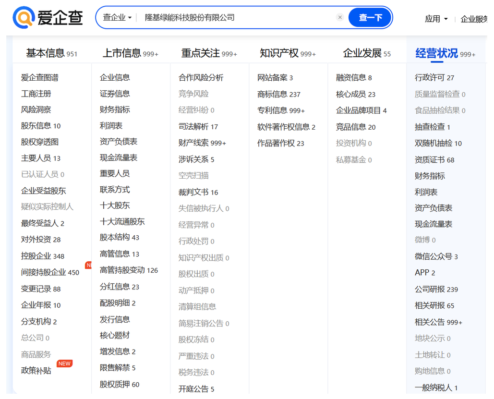

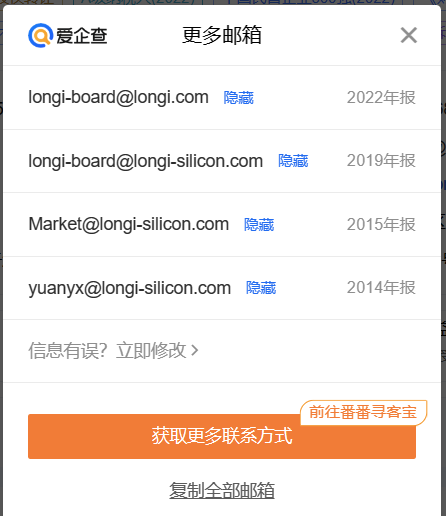

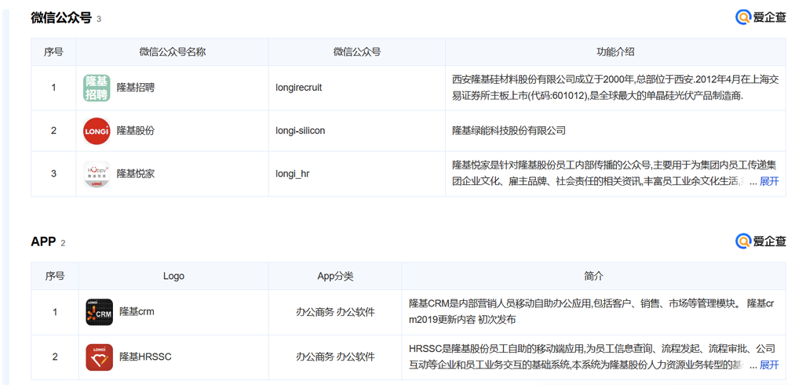

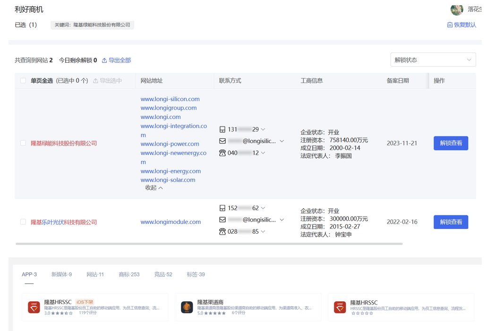

#### 小蓝本

更侧重整理企业的互联网产品和品牌关系，例如：

- ==企业关联网站==
- ==网站对应的备案主体==
- ==App 产品==
- ==微信公众号==
- 商标、品牌和产品
- 关联公司及其网站
- 企业投资、融资等基础信息

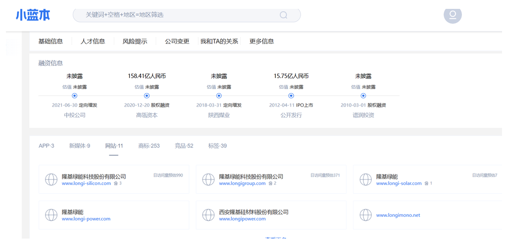

## 3. Web 单域名

先选定一个具体的主域名，然后围绕它查询相关信息：

1. 备案信息
2. 企业产权
3. 注册域名
4. 反查解析

### 3.1 备案信息

利用备案查询网，查看公司是否存在其他分公司：[http://www.beianx.cn/](http://www.beianx.cn/)

下面有三个备案号，说明有三个分公司：

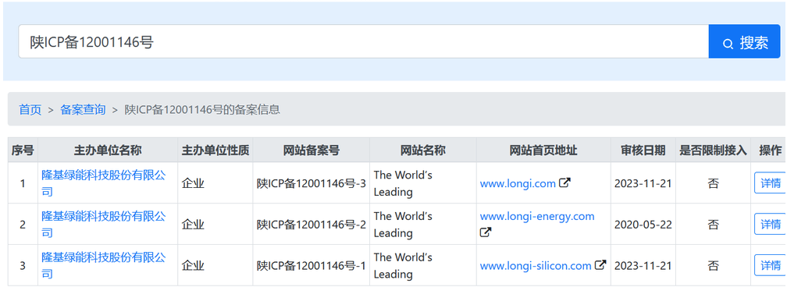

### 3.2 企业产权

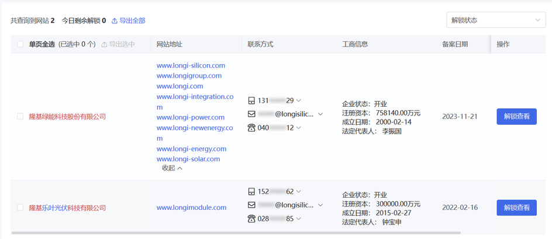

### 3.3 注册域名

通过注册域名查询相关公司的网址：[https://buy.cloud.tencent.com/domain](https://buy.cloud.tencent.com/domain)

思路是判断某个品牌名称在哪些顶级域名下已经被注册：

```text
longi.com
longi.cn
longi.net
```

然后进一步核实：

- 是否由同一家企业持有
- 是否是企业官网或海外站
- 是否用于品牌保护
- 是否属于第三方或仿冒网站

### 3.4 IP 反查域名

已知某个服务器 IP，查询有哪些域名当前或过去曾经指向这个 IP，从而找到同一服务器上部署的其他网站：

```text
已知 IP：1.2.3.4
反查得到：example.com、shop.example.com
```

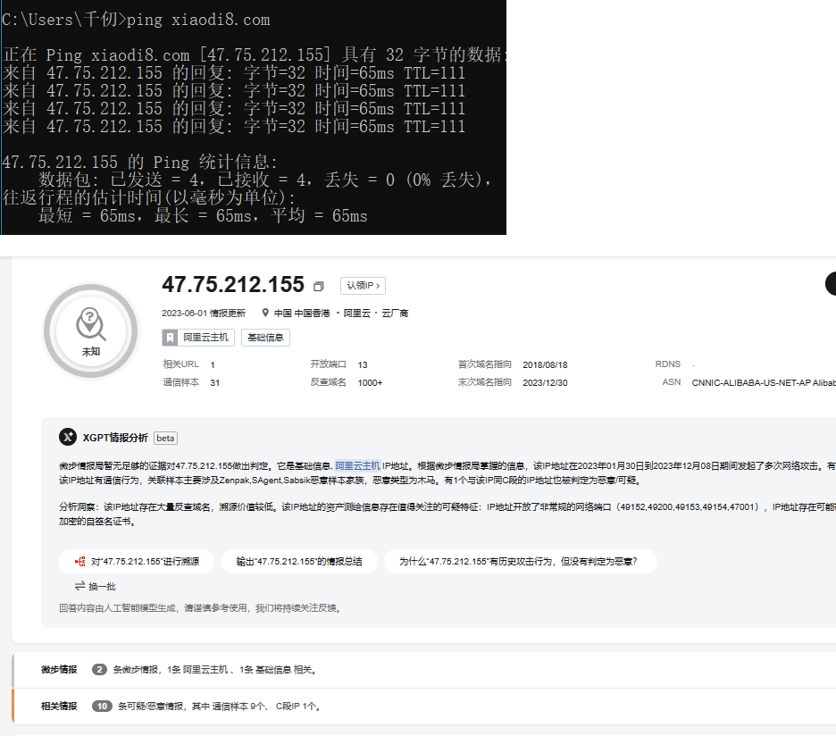

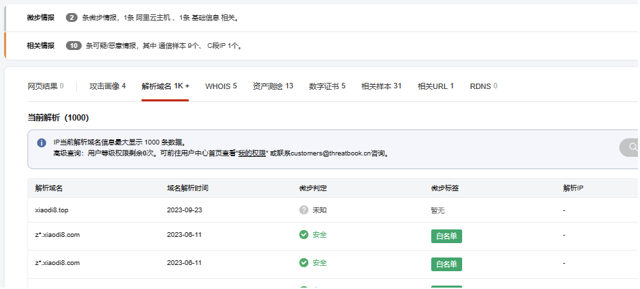

## 4. Web 子域名

五种来源：

1. DNS 数据
2. 证书查询
3. 网络空间
4. 威胁情报
5. 枚举解析

### 4.1 DNS 数据

工具：[DNSDumpster](https://dnsdumpster.com/)

#### 顺便复习 DNS 解析流程

```text
你的电脑问递归 DNS：baidu.com 的 IP 是什么？
        ↓
递归 DNS 问根 DNS：谁负责 .com？
        ↓
根 DNS 返回 .com 顶级域名服务器
        ↓
递归 DNS 问 .com 服务器：谁负责 baidu.com？
        ↓
.com 服务器返回 baidu.com 的 NS 记录：
「这些权威 DNS 服务器负责 baidu.com」
        ↓
递归 DNS 向其中一台权威 DNS 查询：
「baidu.com 的 A 记录是什么？」
        ↓
权威 DNS 返回 A 记录（或先返回 CNAME）
        ↓
递归 DNS 把最终 IP 返回给你的电脑
        ↓
浏览器连接这个 IP
```

DNSDumpster 结果里的 DNS Servers，指的是该域名的**权威 DNS（NS）**，也就是负责管理和回答这个域名解析的服务器。

#### 常见记录类型

| 记录 | 作用 | 示例 |
|---|---|---|
| **MX** | 指定接收该域名邮件的邮件服务器，不是具体邮箱 | `example.com → mail.example.com` |
| **A** | 域名指向 IPv4 地址 | `www.example.com → 1.2.3.4` |
| **AAAA** | 域名指向 IPv6 地址，注意是四个 A | `www.example.com → 2001:db8::1` |
| **CNAME** | 把一个域名设置为另一个域名的别名 | `shop.example.com → store.example.net` |
| **NS** | 指定负责该域名的权威 DNS 服务器 | `example.com → ns1.dns.com` |

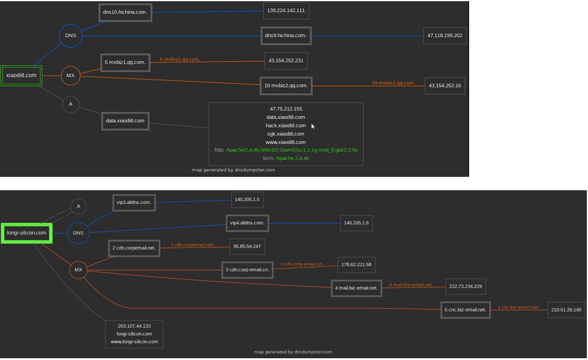

### 4.2 证书查询

工具：[https://crt.sh/](https://crt.sh/)，可以直接查到子域名。

```text
已知主域名 longi.com
  → 查询公开证书
  → 发现证书中出现过的子域名
  → 核实这些域名是否仍存在、是否属于目标企业
```

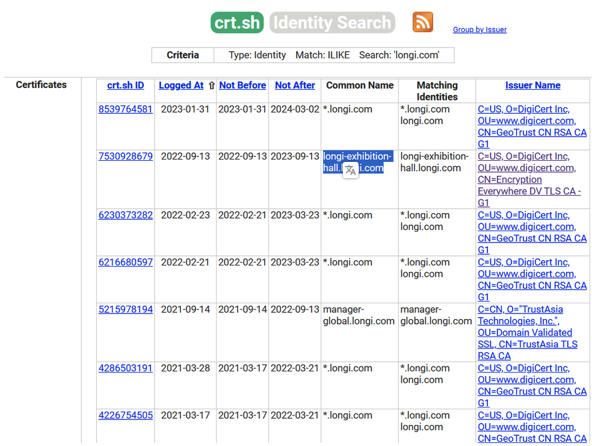

### 4.3 网络空间

- [https://fofa.info/](https://fofa.info/)
- [http://hunter.qianxin.com/](http://hunter.qianxin.com/)
- [https://quake.360.cn/quake/#/index](https://quake.360.cn/quake/#/index)

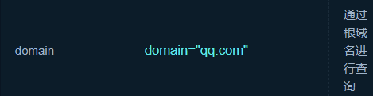

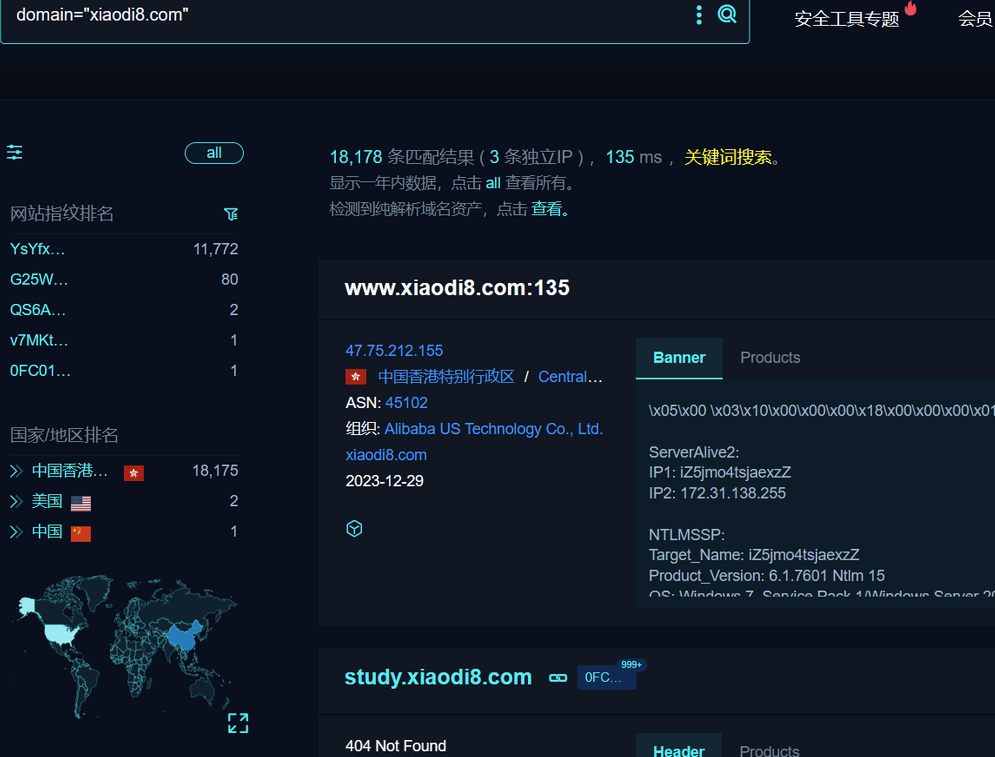

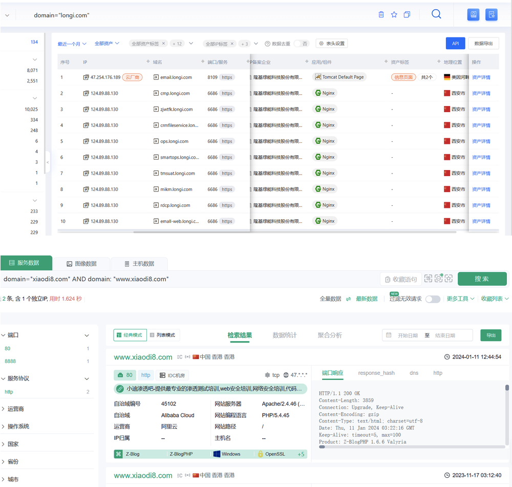

### 4.4 威胁情报

[https://ti.qianxin.com/](https://ti.qianxin.com/)

### 4.5 枚举解析

原理是用字典替换子域名前缀，逐个解析（类似 ping），爆破得到存在的子域名。工具：[https://www.dnsgrep.cn/](https://www.dnsgrep.cn/)

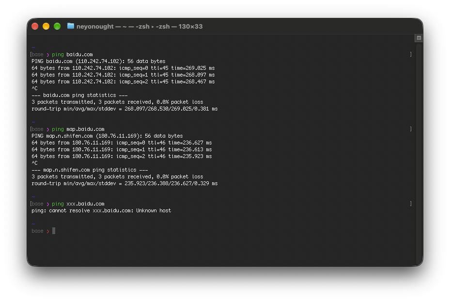

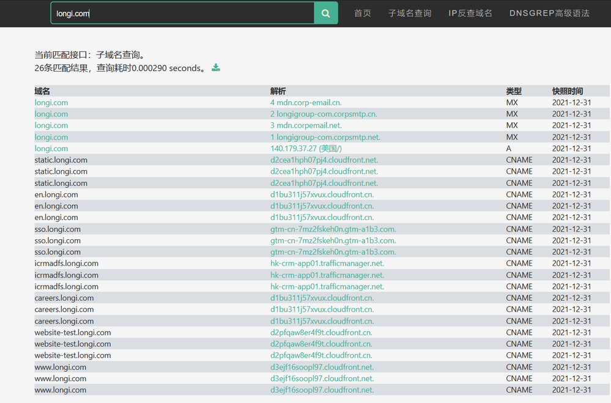

## 5. Web 架构资产

要识别的内容：

1. 程序语言
2. 框架源码
3. 搭建平台
4. 数据库类
5. 操作系统

指纹收录平台：shuziguanxing.com

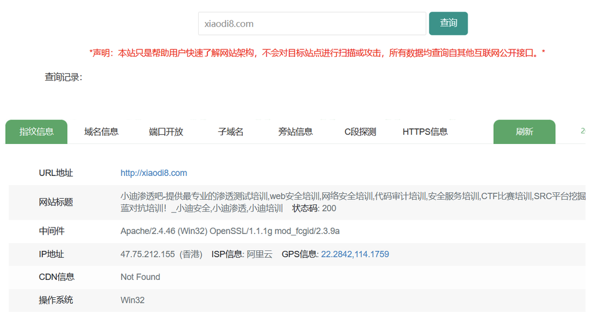

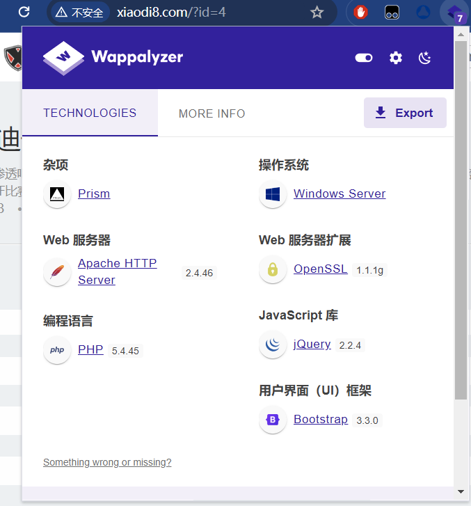

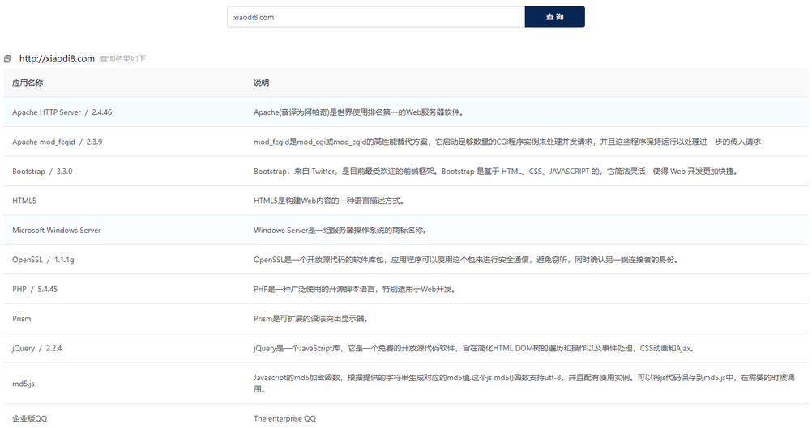

## 6. 附：macOS 用 Docker 安装 OneForAll

这部分步骤由 ChatGPT 整理。

### 6.1 安装 Docker

安装并启动 [Docker Desktop](https://www.docker.com/products/docker-desktop/)，然后检查是否安装成功：

```bash
docker --version
```

### 6.2 下载 OneForAll 镜像

```bash
docker pull shmilylty/oneforall
```

### 6.3 创建结果目录

```bash
mkdir -p "$HOME/OneForAll-results"
```

### 6.4 验证安装

```bash
docker run --rm shmilylty/oneforall --help
```

出现 OneForAll 帮助信息即表示安装成功。

### 6.5 运行 OneForAll

仅对自己拥有或明确获授权的域名使用：

```bash
docker run --rm -it \
  -v "$HOME/OneForAll-results:/OneForAll/results" \
  shmilylty/oneforall \
  --target example.com run
```

参数说明：

- `--rm`：运行结束后自动删除临时容器
- `-it`：显示交互式终端输出
- `-v`：将容器内的结果保存到 Mac 本地
- `--target`：指定要收集的域名

### 6.6 查看结果

打开结果目录：

```bash
open "$HOME/OneForAll-results"
```

主要文件：

- `result.sqlite3`：收集结果数据库
- `oneforall.log`：程序运行日志
- `.csv` 文件：可以用 Excel 或 Numbers 打开

SQLite 数据库可以用 **DB Browser for SQLite** 打开：

```bash
brew install --cask db-browser-for-sqlite
```

通常优先查看名称类似下面的数据表：

```text
目标域名_now_result
```

### 6.7 Docker 的运行方式

每次执行都会基于 OneForAll 镜像创建一个临时容器：

```text
镜像 → 创建临时容器 → 运行程序 → 保存结果到 Mac → 删除容器
```

容器会因为 `--rm` 被自动删除，但 Docker 镜像和本地结果不会被删除。
