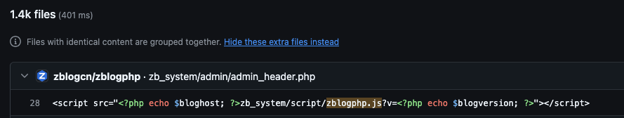

<span class="post-note"><span class="i18n" data-lang="zh">课程为小迪安全官方 2024 年上传，本文为个人学习笔记。</span><span class="i18n" data-lang="en">Course published by XiaoDi Security in 2024. These are my personal study notes.</span></span>

参考：[https://www.secpulse.com/archives/124398.html](https://www.secpulse.com/archives/124398.html)

## 1. 泄露原因

1. 从源码本身的特性入口
2. 从管理员不好的习惯入口
3. 从管理员习惯的开发入口
4. 从管理员不好的配置入口
5. 从管理员不好的意识入口
6. 从管理员资源信息搜集入口

## 2. 泄露合集

### 课上讲了的

| 类型 | 说明 |
|---|---|
| **.git 源码泄露** | 网站公开目录中残留可访问的 `.git`，攻击者可能重建仓库，恢复源码、提交历史及已删除文件。工具比如 GitHack |
| **.svn 源码泄露** | 类似 `.git`，网站公开了 `.svn` 工作副本数据，可能被用来恢复项目文件和仓库信息 |
| **网站备份压缩文件** | `backup.zip`、`www.tar.gz` 等备份文件被留在公开目录，下载后可能得到完整源码、数据库和配置 |
| **DS_Store 文件泄露** | macOS 生成的目录元数据可被下载，可能暴露服务器目录中的文件名和结构 |

### 课上没讲的

| 类型 | 说明 |
|---|---|
| **Webpack 打包泄漏** | 网站发布了未压缩代码或 `.map` 源码映射文件，可能让人还原前端源代码、目录结构和接口信息 |
| **composer.json** | PHP 项目的依赖配置文件可被下载，可能暴露使用的框架、软件包、版本要求和项目结构，但通常不直接包含完整源码 |
| **GitHub 源码泄漏** | 开发者误把私密代码、配置或密钥提交到公开 GitHub 仓库，任何人都可以搜索和下载 |
| **HG 源码泄漏** | Mercurial 项目的 `.hg` 目录被公开，风险类似 `.git`，可能恢复源码和版本历史 |
| **SWP 文件泄露** | Vim 编辑器遗留的 `.swp` 临时文件可被下载，可能包含正在编辑的源码、配置或敏感信息 |
| **CVS 泄露** | 网站公开了 `CVS` 管理目录，可能泄露文件列表、仓库地址、版本信息，部分情况下可辅助恢复源码 |
| **Bzr 泄露** | Bazaar 项目的 `.bzr` 目录被公开，可能导致源码、提交记录及仓库信息泄露 |
| **WEB-INF/web.xml 泄露** | Java Web 应用的部署配置文件因服务器配置错误被下载，可能暴露路由、Servlet、过滤器和安全配置等信息 |

## 3. 思路

### 3.1 能识别出指纹：通过搜索引擎找到源码

先用指纹识别平台查出目标用的是什么源码程序，再去搜索引擎或 GitHub 上找这套源码。

==指纹==：网站暴露出来的、能够识别其所用程序或技术的特征。

比如在 xiaodi8.com 的页面上查看源代码，看里面引用的文件。如果看到了 `/zb_system/script/zblogphp.js`，这就属于指纹。找 `.png` 之类的文件没用，因为它们识别不出技术。然后再去 GitHub 上搜索这个文件。



### 3.2 识别不出指纹：看有没有配置泄漏

- **后端**：借助 SVN、Git、composer.json、DS_Store、备份文件扫描等配置泄漏
- **前端**：Webpack 打包、用浏览器插件获取源码

如果这些问题都没有，还想拿到源码，就用下面的方法。

### 3.3 借助资源平台搜索

在 GitHub、Gitee、OSChina 等源码平台上搜索，线索有两类：

**特定文件**：和 3.1 一样，用网站引用的特征文件名去搜。

**特征联系方式**，可以从这些地方找：

- 网站页脚、关于我们、联系我们页面
- HTML 源码或注释
- 浏览器加载的 JS、CSS 文件及其中的注释
- 前端代码里的作者信息或版权声明
- README、接口文档、报错页面
- 邮箱、QQ、微信号、作者昵称、公司名、域名等

找到之后拿去 GitHub 上搜索。

### 3.4 GitHub 监控

除了找源码，监控漏洞更新、工具更新等也有用处。关键是判断目标使用的源码是开源还是闭源、是否公开。

## 4. 演示案例

| # | 案例 | 工具 |
|---|---|---|
| 1 | 已知指纹识别获取源码 | |
| 2 | Git 泄漏（未知指纹） | [GitHack](https://github.com/lijiejie/GitHack) |
| 3 | SVN 泄漏（未知指纹） | [SvnHack](https://github.com/callmefeifei/SvnHack) |
| 4 | DS_Store 泄漏（未知指纹） | [ds_store_exp](https://github.com/lijiejie/ds_store_exp) |
| 5 | Webpack 打包（未知指纹） | [SourceDetector](https://github.com/NothingCw/SourceDetector-dist) |
| 6 | composer.json（未知指纹） | |
| 7 | 源码文件备份泄漏（未知指纹） | 用目录文件扫描工具确认文件存在，然后直接访问 |
| 8 | GitHub 资源搜索（未知指纹） | |
| 9 | 另类目标源码获取 | [互站网](https://www.huzhan.com/)、[闲鱼](https://www.goofish.com/) |

通用工具：[dumpall](https://github.com/0xHJK/dumpall)，Git、SVN、DS_Store 都能处理。

第 9 种的思路是反过来：从目标转到寻找它卖的源码系统，再从源码系统找到使用它的其他目标。

## 5. 拓展

### GitHub 搜索语法

| 语法 | 含义 |
|---|---|
| `in:name test` | 仓库标题含有关键字 |
| `in:description test` | 仓库描述含有关键字 |
| `in:readme test` | README 文件含有关键字 |
| `stars:>3000 test` | stars 数量大于 3000 |
| `stars:1000..3000 test` | stars 数量在 1000 到 3000 之间 |
| `forks:>1000 test` | forks 数量大于 1000 |
| `forks:1000..3000 test` | forks 数量在 1000 到 3000 之间 |
| `size:>=5000 test` | 仓库大小不小于 5000 KB（5 MB） |
| `pushed:>2019-02-12 test` | 最近推送时间晚于 2019-02-12 |
| `created:>2019-02-12 test` | 创建时间晚于 2019-02-12 |
| `user:test` | 指定用户名 |
| `license:apache-2.0 test` | 指定仓库的 LICENSE |
| `language:java test` | 在 Java 代码中搜索关键字 |
| `user:test in:name test` | 组合搜索：用户 test 名下、标题含 test 的仓库 |

### 关键字配合谷歌搜索

```text
site:github.com smtp
site:github.com smtp @qq.com
site:github.com smtp @126.com
site:github.com smtp @163.com
site:github.com smtp @sina.com.cn
site:github.com smtp password
site:github.com String password smtp
```
