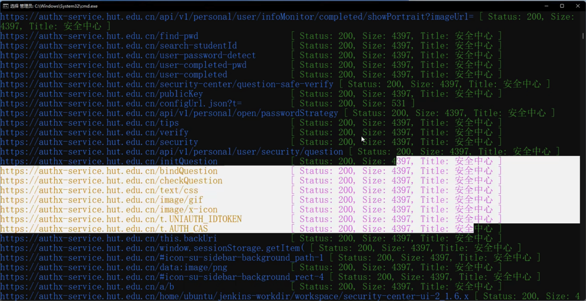

<span class="post-note"><span class="i18n" data-lang="zh">课程为小迪安全官方 2024 年上传，本文为个人学习笔记。</span><span class="i18n" data-lang="en">Course published by XiaoDi Security in 2024. These are my personal study notes.</span></span>

「==打点==」是网络安全中的口语，指**收集、识别并标记有价值的信息或潜在突破口**，接近「信息收集」和「侦察」。

**演示案例**

- JS 前端架构：手工搜索分析
- JS 前端架构：半自动 Burp 分析
- JS 前端架构：自动化项目分析

## 0. 基础概念

### 0.1 CMS

==CMS== 是 **Content Management System** 的缩写，中文叫**内容管理系统**。它让用户不必从零写代码，也能通过后台发布和管理网站内容，比如发布、编辑文章，上传图片和文件。WordPress、Z-Blog 都是 CMS。

### 0.2 前端和后端：为什么 JS 能看到源码

- **后端语言**：PHP、Java、Python、.NET，浏览器端看不到真实的源代码
- **前端语言**：JavaScript（JS）和 JS 框架，浏览器端能看到真实的源代码

PHP 开发的网站看不到源代码，JS 能看到，F12 就能直接看。

### 0.3 什么是 JS 渗透测试

JavaScript 中也存在变量和函数，当存在可控变量及函数调用时，就可能产生漏洞。

JS 开发的 Web 应用和 PHP、Java、.NET 的区别在于：即使没有源代码，也可以通过浏览器查看源代码，获取真实的测试点，比如获取 URL、获取 JS 敏感信息、获取代码传参等。所以 JS 开发的 Web 应用相当于**白盒测试**（默认有源码参考）。

==一般会在 JS 中寻找更多的 URL 地址（接口地址）==，再针对 JS 代码逻辑（加密算法、API key 配置、验证逻辑等）进行后期安全测试。

**接口地址（API URL）**是前端与服务器交换数据时请求的网络地址。例如登录时，网页中的 JS 可能向下面的地址发送账号和密码：

```text
https://example.com/api/login
```

### 0.4 JS 安全问题

- **源码泄漏**
- **未授权访问**：从 JS 里分析出更多的 URL，访问并确定接口路径
- **敏感 key 泄漏**：JS 文件中可能配置了接口信息（云应用、短信、邮件、数据库等）
- **API 接口安全**：代码中加载、提交的参数传递，以及更多的 URL 路径

### 0.5 流行的 JS 框架

Vue、Node.js、jQuery、Angular 等。

### 0.6 如何判定是 JS 开发的应用

- 插件：Wappalyzer
- 源程序代码简短
- 引入多个 `.js` 文件
- 一般有 `/static/js/app.js` 这类按顺序命名的 JS 文件
- Cookie 中一般有 `connect.sid`

### 0.7 如何获取更多的 JS 文件

三种方式，对应下面三章：

1. **手工**：浏览器搜索
2. **半自动**：Burp Suite 插件
3. **工具化**：各类提取及 FUZZ 项目

## 1. 手工：F12 搜索 JS

用 F12 查看 JS 源代码。==主要目的之一是从前端 JS 中找到接口、链接地址和隐藏路径==，但不只是找地址，也要从中获取其他有用信息。

在 JS 内容中搜索这些关键字，找连接地址和路径：

```text
src=
path=
method:"get"
http.get("
method:"post"
http.post("
$.ajax
http://service.httppost
http://service.httpget
```

## 2. 半自动：Burp Suite

### 2.1 工具一览

1. **自带功能**：`Target -> Site map -> Engagement tools -> Find scripts`
2. **官方插件**：JS Link Finder、JS Miner
3. **第三方插件**：HaE、Unexpected_information
   - HaE：[https://github.com/gh0stkey/HaE](https://github.com/gh0stkey/HaE)，规则配置：[Config.yml](https://raw.githubusercontent.com/gh0stkey/HaE/gh-pages/Config.yml)
   - Unexpected_information：[https://github.com/ScriptKid-Beta/Unexpected_information](https://github.com/ScriptKid-Beta/Unexpected_information)，用来标记请求包中的敏感信息、JS 接口和特殊字段，防止疏忽了一些数据包，可能会有意外的收获
4. **插件加载器**：`jython-standalone-2.7.2`

这些工具都是帮你从 Burp 捕获的网页流量和 JavaScript 文件中，快速整理接口、路径及敏感信息：

| 工具 | 主要作用 | 是否主动发请求 |
|---|---|---|
| Find scripts | 找出网站加载的 JavaScript 文件 | 通常不额外扫描 |
| JS Link Finder | 从 JS 文件中提取接口、URL、路径 | 主要是被动分析 |
| JS Miner | 接口、密钥、子域名、云地址、Source Map | 部分功能会主动请求 |
| HaE Network | 按 YAML 规则匹配任何 HTTP 信息，提取和高亮 HTTP 数据（邮箱、手机号、Token、路径） | 通常被动分析 |
| Unexpected_information | 固定类型的敏感信息和 JS 接口（身份证、内网 IP、JWT、URL） | 通常被动分析 |
| Jython | 为 Python 编写的 Burp 插件提供运行环境 | 不分析流量 |

**主动和被动的区别**

- **被动分析**：只检查浏览器正常访问网站时，已经经过 Burp 的请求和响应，通常不会为了扫描而额外请求服务器
- **主动分析**：根据已有线索，另外构造并发送请求，检查某个路径或情况。流程是：发现线索 → 插件构造新请求 → 发送给服务器 → 根据响应判断结果

### 2.2 Find scripts

Burp 自带功能，不是插件。作用是从 Site map 中整理目标使用的脚本文件，例如：

```text
/app.js
/static/js/main.js
/login.js
```

适合先找出「需要分析哪些 JS 文件」。

### 2.3 JS Link Finder

专门从 JavaScript 内容中查找可能的：

- API 接口
- 相对路径
- 后台路径
- 文件地址
- 外部链接

例如从 JS 中发现：

```js
url: "/api/user/login"
```

它比较专一，重点就是「从 JS 找链接和接口」。

### 2.4 JS Miner

功能比 JS Link Finder 更全面，可以检查：

- API 接口
- 子域名
- 云服务地址
- 疑似密钥或凭证
- Source Map 文件
- JavaScript 和 JSON 中的其他信息

部分功能会猜测 `.map` 文件地址并发出请求，所以使用主动功能前要确认目标在授权范围内。它也可能产生误报，需要人工判断。

#### 补充：Source Map

Source Map 是一种**把压缩、打包后的前端代码对应回原始源代码**的文件，通常以 `.map` 结尾，比如 `app.js` 对应 `app.js.map`。

压缩后的代码：

```js
function a(b){return fetch("/api/user/"+b)}
```

通过 Source Map 还原出的原始代码：

```js
// src/api/user.js
function getUser(userId) {
    return fetch("/api/user/" + userId);
}
```

### 2.5 HaE Network

HaE 是一个**流量高亮和信息提取框架**，利用正则规则检查 Burp 捕获的请求和响应。

可以发现：

- 接口路径
- 身份令牌
- 邮箱、手机号
- 内网 IP
- 敏感字段
- 特殊响应内容

匹配后会：

- 给 Proxy History 中的请求着色
- 添加标记或注释
- 把匹配结果集中显示在数据面板

它的优势是规则可以自定义，适合持续查看大量 HTTP 流量。

### 2.6 Unexpected_information

作用和 HaE 有些相似，但功能更固定、简单。主要自动识别：

- 手机号、邮箱、身份证号
- 内网 IP
- JWT
- JS 中的接口和 URL
- `password`、`method: "post"` 等特殊字段

匹配后会给请求行着色，并在 `Unexpected information` 标签中显示结果。

由于它和 HaE 的功能重合，同时开启可能出现重复高亮。

### 2.7 推荐搭配

初学时不需要全部同时开启，建议：

| 目的 | 工具 |
|---|---|
| 找 JS 文件 | Find scripts |
| 提取 JS 接口 | JS Link Finder 或 JS Miner |
| 检查并高亮所有流量 | HaE Network |
| 运行旧 Python 插件 | Jython |

Unexpected_information 和 HaE 二选一即可。

## 3. 自动化：插件与工具

### 3.1 FindSomething 浏览器插件

全自动、被动提取：

- 网站域名和外部链接
- 接口及文件路径
- Vue 组件路径，例如 `/components/.../*.vue`
- 手机号、身份证号、邮箱
- JWT 等可能的敏感信息

### 3.2 URLFinder：分析 JS

[https://github.com/pingc0y/URLFinder](https://github.com/pingc0y/URLFinder)

一款用于快速提取、检测页面中 JS 与 URL 的命令行工具，是 JSFinder 的升级版。JSFinder 是快速从网站 JS 文件中提取 URL、子域名的工具，但已经很久没更新了。

URLFinder 能做到：

- 爬取网页中的链接
- 收集 JS 文件
- 从 JS 中提取接口和 URL
- 查找相关域名和子域名
- 验证发现的地址是否可以访问
- 显示状态码及响应大小
- 整理结果并生成报告



工具也帮着自动访问了，能看到状态码：


### 3.3 JSINFO-SCAN：分析 JS

[https://github.com/plg3/JSINFO-SCAN](https://github.com/plg3/JSINFO-SCAN)

递归爬取域名（netloc / domain），以及递归从 JS 中获取信息的工具。

### 3.4 ffuf：找到更多 JS 文件

- [https://github.com/ffuf/ffuf](https://github.com/ffuf/ffuf)
- 字典：[https://wordlists.assetnote.io](https://wordlists.assetnote.io)

**ffuf 是一个高速模糊测试工具**。它读取字典里的内容，逐条替换请求中的 `FUZZ`，然后向服务器发送请求并比较响应。

和爬虫的区别：

- **爬虫**：跟随网页中已经存在的链接（F12 页面中展示的 JS 也就那么几个）
- **ffuf**：根据字典猜测没有显示出来的路径

比如字典里有 admin、login、api、backup，请求 `https://example.com/FUZZ` 时，就会把 `FUZZ` 依次换成字典里的词去请求。`FUZZ` 可以放在不同的位置：

```text
https://example.com/js/FUZZ
https://FUZZ.example.com
https://example.com/search?id=FUZZ
```

### 3.5 Packer-Fuzzer

[https://github.com/rtcatc/Packer-Fuzzer](https://github.com/rtcatc/Packer-Fuzzer)

一款针对 Webpack 等前端打包工具所构造的网站，进行快速、高效安全检测的扫描工具。

Webpack 是给 JS 代码打包的工具，有一些项目用 Webpack 打包。

## 4. 完整流程：先分析，再补漏

核心原则：**先分析已知内容，再用 ffuf 补漏。**

### 4.1 步骤

```text
1. 正常浏览网站并抓取流量
2. Find scripts / F12 找到网站实际加载的 JS
3. JSFinder、JS Miner 或 AI 分析 JS
4. 提取接口、目录和 JS 命名规律
5. 根据已有线索选择小而准确的字典
6. 用 ffuf 在授权范围内查找遗漏路径
7. 再分析新发现的 JS 或接口
```

### 4.2 例子

先发现网站加载了：

```text
/static/js/app.abc123.js
/static/js/chunk-user.def456.js
```

分析后知道它的命名规律是：

```text
/static/js/chunk-业务名.哈希.js
```

再有针对性地寻找可能遗漏的业务分包，比直接拿几百万条字典盲猜更有效。

### 4.3 工具分工

```text
F12 / Burp / Find scripts
→ 收集页面实际使用的资源

JS 分析工具 / AI
→ 阅读 JS，提取接口、路由和命名规律

ffuf
→ 根据字典猜测没有直接加载或引用的资源

再次分析
→ 检查新发现的 JS 和路径
```

所以这是一个循环：

```text
发现已知 JS → 分析线索 → 定向 Fuzz 补漏 → 分析新结果
```

### 4.4 注意事项

- 不建议一开始就使用两百多万条字典和高并发，会产生大量请求、误报和服务器压力
- 发现含 `delete`、`remove`、`sendCode`、`pay` 等操作型接口时，不要直接批量访问
- 只在自己或明确授权的系统中进行
