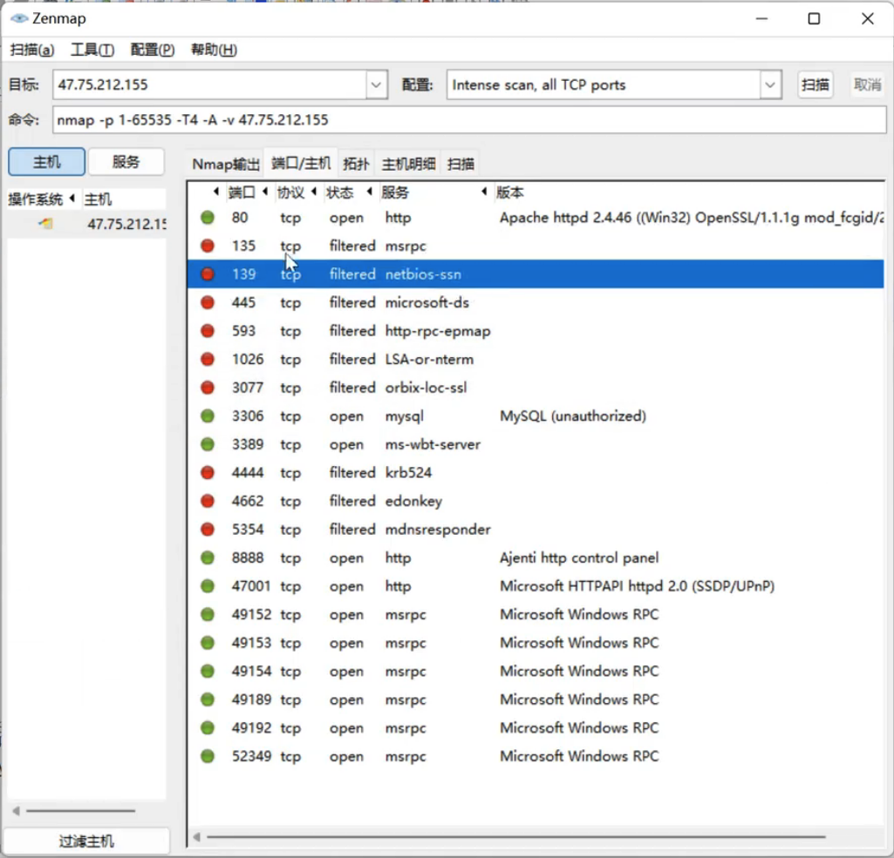
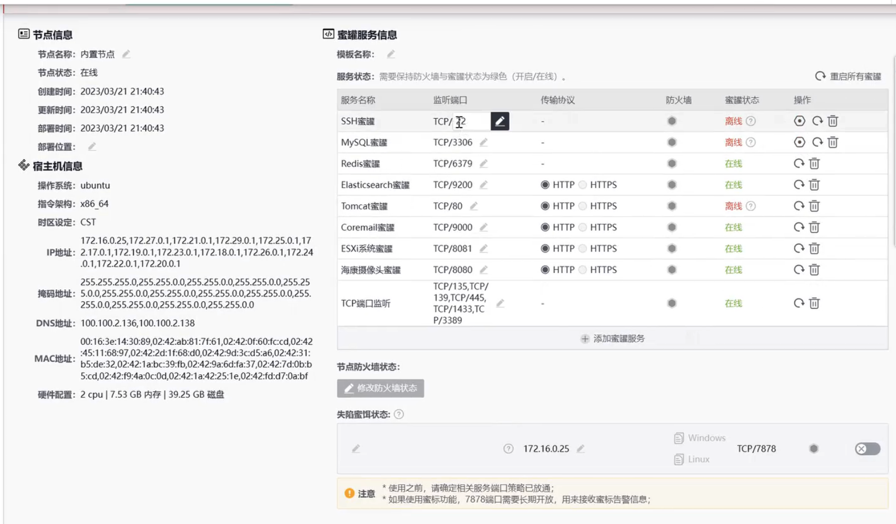
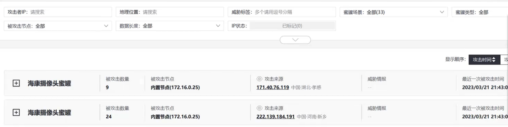
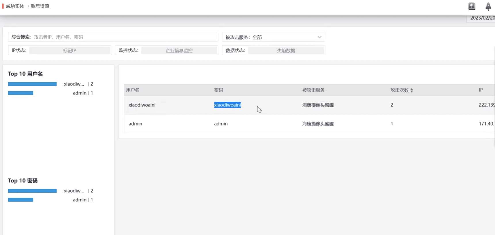
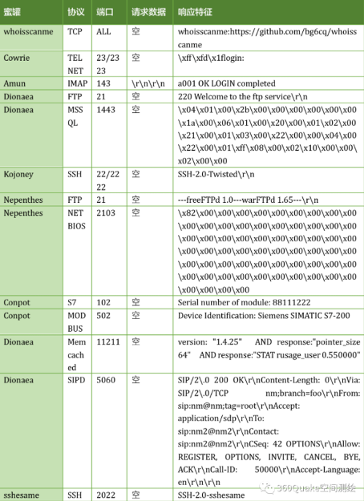

<span class="post-note"><span class="i18n" data-lang="zh">课程为小迪安全官方 2024 年上传，本文为个人学习笔记。</span><span class="i18n" data-lang="en">Course published by XiaoDi Security in 2024. These are my personal study notes.</span></span>

## 0. 知识点

> **为什么要学**：一个网站背后不只有 Web 服务，还有中间件、数据库、防火墙，甚至可能是蜜罐。先把这些识别清楚，才能判断攻击面有多大、该怎么测、要避开什么。

- 识别-Web服务器-请求返回包
- 识别-应用服务器-端口扫描技术
- 识别-其他服务协议-端口扫描技术
- 识别-WAF防火墙-看图&项目&指纹
- 识别-蜜罐平台-人工&网络空间&项目

## 1. 主机架构识别：端口扫描

> **为什么要学**：网站本身防护再好，同一台主机上开放的其他服务也可能是突破口。端口扫描是摸清一台主机对外暴露了哪些服务的基本手段。

### 1.1 识别对象

> **为什么要学**：知道中间件、数据库和其他服务分别是什么，才能针对具体软件和版本去查已知问题，而不是只盯着网页本身。

- Web中间件探针
- 应用中间件探针
- 数据库类型探针
- 其他服务协议探针

Web服务器和应用服务器（开放特别端口）统称中间件。
不同的协议有不同的端口，端口扫描就是判断除了网站以外还有没有其他服务。

### 1.2 扫描工具

> **为什么要学**：不同工具在速度和精度上各有侧重，网络空间平台还能不直接接触目标就查到历史端口信息。了解它们的特点，才能按场景选用。

端口扫描：Nmap、Masscan、网络空间

https://nmap.org/download.html

https://github.com/robertdavidgraham/masscan

Nmap, Masscan, FOFA 输入IP都能扫描到开放地址（具体命令用的时候搜索）

### 1.3 端口开放状态

> **为什么要学**：读懂扫描结果是判断的前提。filtered 往往说明有防火墙，这本身也是关于目标网络结构的重要信息。

开放状态：Close Open Filtered


⬆️ Nmap扫描之后有三种状态open, close, filtered
有防火墙的话就有filtered

### 1.4 常见端口与服务安全

> **为什么要学**：看到一个开放端口，要能马上想到它对应什么服务、常见风险在哪里，这样扫描结果才变成有用的测试方向。防守方也能据此检查哪些服务不该暴露在公网。

| **端口** | **服务** | **渗透用途** |
| --- | --- | --- |
| tcp 20,21 | FTP | 允许匿名的上传下载,爆破,嗅探,win提权,远程执行(proftpd 1.3.5),各类后门(proftpd,vsftp 2.3.4) |
| tcp 22 | SSH | 可根据已搜集到的信息尝试爆破,v1版本可中间人,ssh隧道及内网代理转发,文件传输等等 |
| tcp 23 | Telnet | 爆破,嗅探,一般常用于路由,交换登陆,可尝试弱口令 |
| tcp 25 | SMTP | 邮件伪造,vrfy/expn查询邮件用户信息,可使用smtp-user-enum工具来自动跑 |
| tcp/udp 53 | DNS | 允许区域传送,dns劫持,缓存投毒,欺骗以及各种基于dns隧道的远控 |
| tcp/udp 69 | TFTP | 尝试下载目标及其的各类重要配置文件 |
| tcp 80-89,443,8440-8450,8080-8089 | 各种常用的Web服务端口 | 可尝试经典的topn,vpn,owa,webmail,目标oa,各类Java控制台,各类服务器Web管理面板,各类Web中间件漏洞利用,各类Web框架漏洞利用等等…… |
| tcp 110 | POP3 | 可尝试爆破,嗅探 |
| tcp 111,2049 | NFS | 权限配置不当 |
| tcp 137,139,445 | Samba | 可尝试爆破以及smb自身的各种远程执行类漏洞利用,如,ms08-067,ms17-010,嗅探等…… |
| tcp 143 | IMAP | 可尝试爆破 |
| udp 161 | SNMP | 爆破默认团队字符串,搜集目标内网信息 |
| tcp 389 | LDAP | ldap注入,允许匿名访问,弱口令 |
| tcp 512,513,514 | Linux rexec | 可爆破,rlogin登陆 |
| tcp 873 | Rsync | 匿名访问,文件上传 |
| tcp 1194 | OpenVPN | 想办法钓VPN账号,进内网 |
| tcp 1352 | Lotus | 弱口令,信息泄漏,爆破 |
| tcp 1433 | SQL Server | 注入,提权,sa弱口令,爆破 |
| tcp 1521 | Oracle | tns爆破,注入,弹shell… |
| tcp 1500 | ISPmanager | 弱口令 |
| tcp 1723 | PPTP | 爆破,想办法钓VPN账号,进内网 |
| tcp 2082,2083 | cPanel | 弱口令 |
| tcp 2181 | ZooKeeper | 未授权访问 |
| tcp 2601,2604 | Zebra | 默认密码zerbra |
| tcp 3128 | Squid | 弱口令 |
| tcp 3312,3311 | kangle | 弱口令 |
| tcp 3306 | MySQL | 注入,提权,爆破 |
| tcp 3389 | Windows rdp | shift后门[需要03以下的系统],爆破,ms12-020 |
| tcp 3690 | SVN | svn泄露,未授权访问 |
| tcp 4848 | GlassFish | 弱口令 |
| tcp 5000 | Sybase/DB2 | 爆破,注入 |
| tcp 5432 | PostgreSQL | 爆破,注入,弱口令 |
| tcp 5900,5901,5902 | VNC | 弱口令爆破 |
| tcp 5984 | CouchDB | 未授权导致的任意指令执行 |
| tcp 6379 | Redis | 可尝试未授权访问,弱口令爆破 |
| tcp 7001,7002 | WebLogic | Java反序列化,弱口令 |
| tcp 7778 | Kloxo | 主机面板登录 |
| tcp 8000 | Ajenti | 弱口令 |
| tcp 8009 | tomcat Ajp | Tomcat-Ajp协议漏洞 |
| tcp 8443 | Plesk | 弱口令 |
| tcp 8069 | Zabbix | 远程执行,SQL注入 |
| tcp 8080-8089 | Jenkins,JBoss | 反序列化,控制台弱口令 |
| tcp 9080-9081,9090 | WebSphere | Java反序列化/弱口令 |
| tcp 9200,9300 | ElasticSearch | 远程执行 |
| tcp 11211 | Memcached | 未授权访问 |
| tcp 27017,27018 | MongoDB | 爆破,未授权访问 |
| tcp 50070,50030 | Hadoop | 默认端口未授权访问 |

### 1.5 端口扫不到的情况

> **为什么要学**：扫不到不等于服务不存在。理解防火墙和内网结构的影响，才不会误判，也能推测目标的网络架构。

==考虑：1. 防火墙 2. 内网环境==

内网环境可能出现情况：明明数据库端口开的，网站也能正常打开，但是你对目标进行端口扫描，发现数据库端口没有开放（排除防火墙问题）

#### 反向代理

> **为什么要学**：很多网站对外只暴露反向代理，真实服务器在后面。明白这一点，就能解释为什么外部扫描结果和实际部署对不上。

反向代理：位于客户端和后端服务器之间的服务器。==客户端只和反向代理通信，由它把请求转发给合适的后端服务器==，再把结果返回给客户端。

反向代理的作用：
- **负载均衡**：把请求分配给多台服务器，避免某一台压力过大。
- **隐藏后端**：客户端无法直接看到后端服务器的地址和结构。
- **HTTPS 处理**：由代理统一管理证书和加密连接。
- **缓存**：直接返回缓存内容，减少后端压力。
- **安全防护**：进行限流、访问控制和恶意请求过滤。
- **统一入口**：根据域名或路径把请求转发给不同服务

比如攻击者扫描用反向代理的外网IP实际上是扫描不到内网里面的服务器的

## 2. WAF 识别

> **为什么要学**：有没有 WAF、是哪种 WAF，直接影响后续测试的方式和结果。先识别出来，才能解释为什么请求被拦，也能判断测试需要多谨慎。

### 2.1 什么是 WAF

> **为什么要学**：WAF 是目前网站最常见的防护手段之一，先理解它是在 HTTP 层按规则检查请求，才能明白它能挡什么、挡不了什么。

Web应用防护系统（也称为：网站应用级入侵防御系统。英文：Web Application Firewall，简称：WAF）。利用国际上公认的一种说法：Web应用防火墙是通过执行一系列针对HTTP/HTTPS的安全策略来专门为Web应用提供保护的一款产品。

### 2.2 WAF 分类

> **为什么要学**：不同类型的 WAF 部署位置和防护强度差别很大，云 WAF 还常和 CDN 绑在一起。知道目标属于哪一类，才能对测试难度有合理预期。

常见：

**云WAF**（安全等级最高）：百度安全宝、阿里云盾、华为云、亚马逊云等；国外常见的有 Cloudflare WAF、AWS WAF、Microsoft Azure WAF、Google Cloud Armor、Akamai、Imperva Cloud WAF 等。

**硬件WAF**：绿盟、安恒、深信服、知道创宇等公司的商业产品；国外常见的有 F5 Advanced WAF、Fortinet FortiWeb、Barracuda WAF、Imperva、Radware AppWall 等。

**软件WAF**（个人，小中型，灰产没有经济能力）：宝塔、安全狗、D盾、长亭雷池等；国外常见的有 ModSecurity、OWASP CRS、Coraza WAF、open-appsec、NAXSI 等。

**代码级WAF**：开发者自己编写安全规则，通过应用代码、框架中间件或安全库检查请求，防止SQL注入、XSS等攻击，一般与具体业务逻辑结合。在国外语境下通常称为 **In-application WAF、Application-level filtering**，如果具备运行时检测与拦截能力，也可能称为 **RASP（Runtime Application Self-Protection，运行时应用自我保护）**。

### 2.3 WAF 识别方法

> **为什么要学**：WAF 通常不会主动告诉你它的存在，需要借助工具或网络空间平台的指纹来判断，这样能在正式测试前心里有数。

#### 项目识别

1、wafw00f
```
https://jmhewang.com/
https://223.111.128.103:9808/
https://login.bescloud.huawei.com/
```
2、identywaf
```
https://jmhewang.com/
http://order-disk.zhaopin.com/
```

#### 网络空间识别

网络空间也能识别出WAF类型

## 3. 蜜罐识别

> **为什么要学**：蜜罐专门用来诱骗和记录攻击者，误把蜜罐当成真实目标，既浪费时间，又会暴露自己的信息。站在防守角度，了解识别方法也能帮助把蜜罐做得更逼真。

### 3.1 什么是蜜罐

> **为什么要学**：理解蜜罐的本质是引诱和记录，才能明白它为什么看起来漏洞很多、很好打，以及它对防守方的价值。

蜜罐：一种安全威胁的检测技术，其本质在于引诱和欺骗攻击者，并且通过记录攻击者的攻击日志来产生价值。安全研究人员可以通过分析蜜罐的被攻击记录推测攻击者的意图和手段等信息。攻击方可以通过蜜罐识别技术来发现和规避蜜罐。因此，我们有必要站在红队攻击者的角度钻研蜜罐识别的方式方法。

### 3.2 蜜罐分类与产品

> **为什么要学**：不同交互程度和模拟对象的蜜罐，表现出来的特征不一样。了解分类，识别时才知道该看哪些方面。

根据蜜罐与攻击者之间进行的交互的程度可以将蜜罐分为三类：低交互蜜罐、中交互蜜罐、高交互蜜罐。当然还可以根据蜜罐模拟的目标进行分类，比如：数据库蜜罐、工控蜜罐、物联网蜜罐、Web蜜罐等等。

蜜罐产品：见 3.5 的 Quake 搜索语法表

### 3.3 蜜罐如何记录攻击者

> **为什么要学**：亲自看到蜜罐能记录下 IP、账号密码字典等信息，就会明白随手爆破或访问可疑服务的风险有多大。

可以弄一台Linux服务器 然后在服务器上面部署蜜罐，再去管理页面登录自带的账号密码。https://47.94.236.117:4433/web/dashboard


⬆️ 钓鱼开放端口 比如8080

然后攻击者登录https://47.94.236.117:8080
就会显示

⬆️记录IP


⬆️记录密码字典

ssh mysql应用蜜罐 搞一个可以爆破的地方
爆破 蜜罐会记录攻击者的账号密码
账号密码会采用web jsonp去传输（web功能）
转发 跳转 jsonp去传输
当你去web http去访问这个端口 采用协议去下载文件

普通网站正常访问 但是蜜罐可能会==下载==

### 3.4 识别原理

> **为什么要学**：工具和平台的识别结果都来自这些原理，懂了原理，工具没识别出来时也能自己判断，而不是完全依赖工具。

https://mp.weixin.qq.com/s/jPz9hBmUypFyQ1U27vg1Ug



### 3.5 工具与网络空间识别

> **为什么要学**：工具和网络空间平台积累了大量已知蜜罐的指纹，用它们先快速筛一遍，比完全靠人工分析省时。

#### 浏览器插件

浏览器插件Heimdallr

https://github.com/graynjo/Heimdallr

#### quake.exe

quake.exe识别软件，就是接入quake的网络空间

https://github.com/360quake/quake_rs

 `quake.exe init apikey`
 `quake.exe honeypot 目标`

#### 网络空间

鹰图，Quake

| **蜜罐** | **Quake系统搜索语法** |
| --- | --- |
| StrutsHoneypot | app:"StrutsHoneypot" |
| Conpot HTTP 蜜罐 | app:"Conpot Http 蜜罐" |
| Conpot Modbus 蜜罐 | app:"Conpot modbus 蜜罐" |
| Conpot S7 蜜罐 | app:"Conpot s7 蜜罐" |
| Kippo 蜜罐 | app:"kippo 蜜罐" |
| Honeypy HTTP 蜜罐 | app:"Honeypy Http 蜜罐" |
| Honeypy ES 蜜罐 | app:"Honeypy ES蜜罐" |
| Amun IMAP 蜜罐 | app:"amun imap 蜜罐" |
| Amun HTTP 蜜罐 | app:"amun http蜜罐" |
| Nepenthes NetBIOS 蜜罐 | app:"Nepenthes netbios蜜罐" |
| Nepenthes FTP 蜜罐 | app:"Nepenthes FTP 蜜罐" |
| sshesame SSH 蜜罐 | app:"sshesame ssh 蜜罐" |
| OpenCanary 蜜罐管理后台 | app:"opencanary蜜罐管理后台" |
| Dionaea SIPD 蜜罐 | app:"Dionaea sipd 蜜罐" |
| Dionaea SMBD 蜜罐 | app:"Dionaea smbd 蜜罐" |
| Dionaea HTTP 蜜罐 | app:"Dionaea Http 蜜罐" |
| Dionaea MSSQL 蜜罐 | app:"Dionaea MSSQL 蜜罐" |
| Dionaea FTP 蜜罐 | app:"Dionaea ftp 蜜罐" |
| Dionaea Memcached 蜜罐 | app:"Dionaea Memcached 蜜罐" |
| Kojoney SSH 蜜罐 | app:"Kojoney SSH 蜜罐" |
| WebLogic 蜜罐 | app:"weblogic蜜罐" |
| MySQL 蜜罐 | app:"MySQL蜜罐" |
| HFish 蜜罐 | app:"HFish蜜罐" |
| HFish 蜜罐管理后台 | app:"HFish蜜罐管理后台" |
| HoneyThing 物联网蜜罐 | app:"honeything物联网蜜罐" |
| Elasticsearch 蜜罐 | app:"elasticsearch蜜罐" |
| HostUS 蜜罐 | app:"HostUS蜜罐" |
| whoisscanme 蜜罐 | app:"whoisscanme蜜罐" |
| 未知蜜罐 | app:"未知蜜罐" |
| Cowrie telnetd 蜜罐 | app:"Cowrie telnetd蜜罐" |
| Glastopf 蜜罐 | app:"glastopf蜜罐" |

### 3.6 人工分析

> **为什么要学**：新的或改过的蜜罐，工具不一定认得出来，最后还要靠人工结合多个特征综合判断。

1、端口多而有规律性
2、Web访问协议就==下载==
3、设备指纹对应分析

#### 端口多而有规律性

> **为什么要学**：正常业务服务器只开需要的端口，开放端口异常多往往是蜜罐模拟多种服务的迹象，这是最直观的一个可疑点。

**端口多而有规律性**通常是人工分析蜜罐时使用的一个可疑特征
普通服务器一般只开放业务需要的少量端口，例如：
```
22    SSH 管理
80    HTTP
443   HTTPS
3306  MySQL（通常不应公网开放）
```

而某些蜜罐为了吸引不同类型的攻击，会同时模拟很多服务：
```
21    FTP
22    SSH
23    Telnet
80    HTTP
445   SMB
1433  MSSQL
3306  MySQL
3389  RDP
6379  Redis
8080  Web
```

#### 什么叫“有规律性”

> **为什么要学**：单看端口数量容易误判，搞清楚哪些规律是可疑的，才能把蜜罐和普通测试服务器区分开。

常见规律主要有以下几种。

**1. 端口连续或等间隔出现**

例如：8000、8001、8002、8003……
10001、10002、10003……

这可能是批量启动的模拟服务、容器映射或者自动化部署结果。当然，开发测试平台也可能这样配置。

**2. 反复出现固定端口组合**

例如在多个不同 IP 上都看到：

```
21、22、23、80、445、3306、6379
```

并且每个 IP 的响应内容、页面和证书都几乎相同，可能是一批使用同一模板部署的蜜罐节点。

**3. 服务组合不符合现实**

例如一个设备同时表现为：

```
Windows SMB + Linux SSH + 西门子工控设备
+ Redis + 摄像头管理页面
```

技术上并非绝对不可能，但业务身份互相矛盾，可能是蜜罐在一个 IP 上模拟多种目标。

**4. 不同端口返回高度相似的内容**

例如访问多个不同端口，全部返回：

- 相同网页模板
- 相同 HTTP 标头
- 相同 TLS 证书
- 相同错误信息
- 相同响应延迟
- 相同服务器 Banner

这可能说明这些端口由同一个蜜罐框架统一处理，而不是真正独立的服务。

**5. 端口与协议不匹配**

例如：

- HTTP 请求发送到数据库端口，==却返回网页或下载文件==；
- MySQL、Redis、SSH 等端口都返回相似的 HTTP 响应；
- 端口声称运行某协议，但返回内容不符合该协议规范。

#### 人工判断流程

> **为什么要学**：单个特征容易误判，按固定流程收集多个证据再下结论，判断才可靠，也能避免把正常业务当成蜜罐放弃。

在自建环境或明确授权范围内，可以按照下面的思路分析：

```
查看开放端口
→ 判断端口数量和组合是否合理
→ 识别每个端口的真实协议
→ 比较 Banner、证书和响应内容
→ 检查服务之间是否存在矛盾
→ 与已知蜜罐指纹进行比对
→ 使用多个证据综合判断
```

e.g.
```
发现 20 多个高风险端口
+ 多个端口返回相同证书
+ SSH Banner 是某蜜罐默认值
+ 工控设备型号与操作系统矛盾
```

多个特征同时出现，才会比较有把握。

#### 蜜罐样本

http://111.1.73.98:88/
http://118.24.252.213:9827/
https://justeeva.sport.blog/
https://anniezhang.zcool.com.cn/
https://voice.91wangame.com/login
