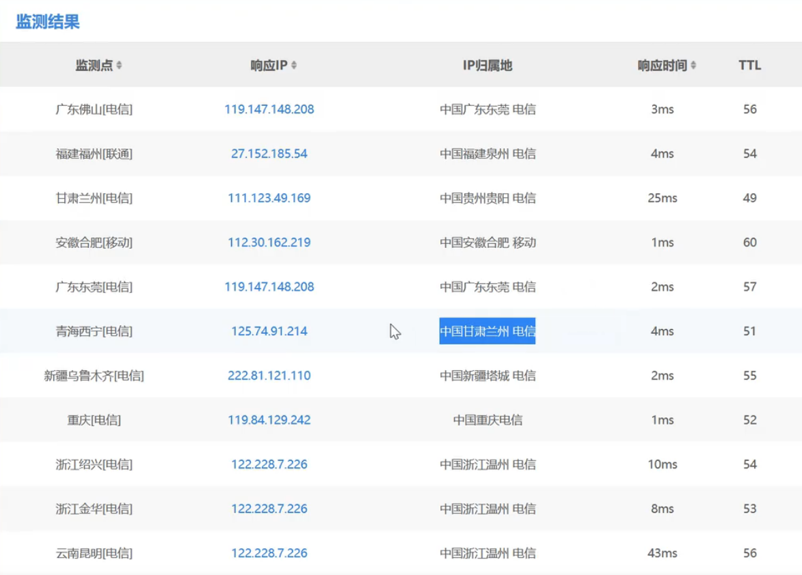
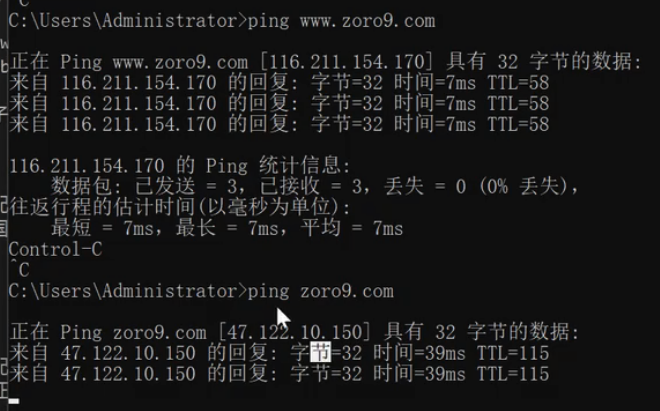
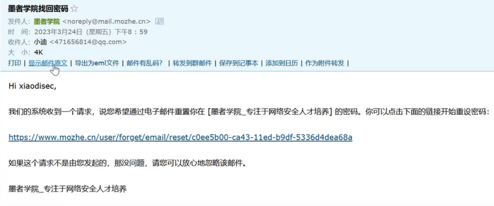
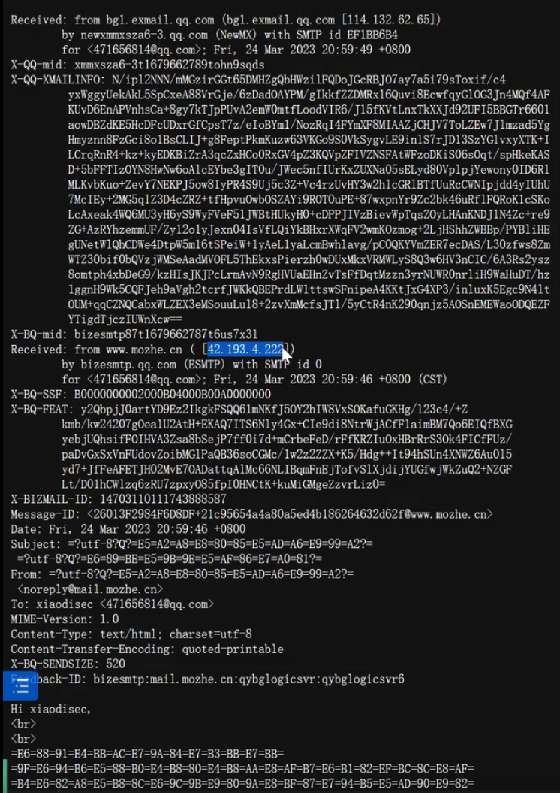
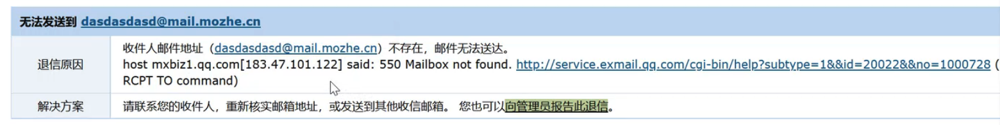
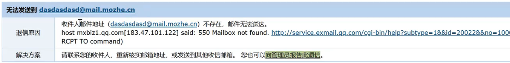

<span class="post-note"><span class="i18n" data-lang="zh">课程为小迪安全官方 2024 年上传，本文为个人学习笔记。</span><span class="i18n" data-lang="en">Course published by XiaoDi Security in 2024. These are my personal study notes.</span></span>

## 0. 前置知识：CDN 访问流程

1. 传统访问：用户访问域名 → 解析服务器 IP → 访问目标主机
2. 普通 CDN：用户访问域名 → CDN 节点 → 真实服务器 IP → 访问目标主机
3. 带 WAF 的 CDN：用户访问域名 → CDN 节点（WAF）→ 真实服务器 IP → 访问目标主机

## 1. 业务部署：从 CDN 配置找突破口

### 1.1 CDN配置1：加速域名

==加速域名——需要启用加速的域名==

子域名获取真实 IP 失效（加速配置有关系）

[www.xiaodi8.com](http://www.xiaodi8.com)　加速
bbs.xiaodi8.com　不加速

bbs这个如果不加速的话就会被找出真实IP

子域名和域名又可能是在同一 IP 或网段
主站和子站可能部署在：
- 同一台服务器，即相同 IP；
- 同一组服务器；
- 同一机房或相邻网段。

所以发现某个未接入 CDN 的子域名后，可以据此判断它是否与主站共用源站。但“同网段”只能作为线索，不能直接证明二者属于同一服务器。

### 1.2 CDN配置2：加速区域

加速区域——需要启用加速的地区

国外访问获取真实 IP：从不同国家或地区查询、访问域名，观察其 DNS 解析结果是否不同。如果某些地区没有进入 CDN 调度，就可能返回源站地址。比如说一个网站开启了中国大陆CDN服务，用一个伊朗的服务器访问就会有真实地址。
==但是子域名和主站不在一个服务器也是可能的==

#### 超级ping

超级ping：17ce.com
它会从国内外多个地区的探测节点查询或访问同一个域名，比较返回结果，用于CDN配置2。


⬆️ 这个就是启用了CDN

### 1.3 CDN配置3：加速类型

加速类型——需要启用加速的资源

- **加速类型**
    CDN 可以只代理特定业务或资源，例如：
    - 静态文件、图片和视频；
    - 动态网页；
    - 下载业务；
    - API 或全站内容。
    如果某类资源或某个端口没有经过 CDN，它仍可能直接连接源站。

- **证书**
    HTTPS 网站接入 CDN 时，CDN 边缘节点通常需要配置对应域名的 TLS/SSL 证书，才能代表该域名与用户建立 HTTPS 连接。证书本身通常不会直接显示源站 IP，但证书中的域名信息、历史证书记录等可能提供关联域名线索。

### 1.4 验证候选 IP：绑定 hosts


ping www.zoro9.com和zoro9.com的IP区别

绑定hosts：上面的图片中 怀疑47.122.10.150是网站真实IP
就在hosts文件里写出47.122.10.150 www.zoro9.com
但是无法访问**不能直接说明 47.122.10.150 不是源站 IP**，但至少说明它不能以当前方式直接承载 `www.zoro9.com`。

## 2. 漏洞回链：使用漏洞来查看真实IP

### 2.1 SSRF.php漏洞查询真实IP

开一个服务器 python2 -m SimpleHTTPServer
然后把地址提交到网站的输入框 http://47.94.236.117:22

⬆️ 得到结果

### 2.2 遗留文件

phpinfo.php。里面的遗留信息 比如访问www.zoro9.com/phpinfo.php

⬆️ 找到内网IP。是不是公网IP 要看服务器是不是公网ip

什么情况下会显示真实公网 IP？
- Web 服务直接绑定在公网网卡上；
- 服务器没有经过 NAT、容器或内部反向代理；
- `phpinfo.php` 由源站直接执行，而不是 CDN/WAF 的节点执行。

## 3. 反向邮件：邮件系统绕过CDN

一般邮件服务没有CDN

### 3.1 让网站主动发邮件给你

注册邮箱，激活处是网站（邮箱）服务器主动发东西给你
点击忘记密码：

⬆️ 显示原文

⬆️ 真实IP地址

上面的网站使用的邮件是自己域名的邮件服务器，如果使用其他公司的邮件系统就不能查到目标的IP地址。

### 3.2 你给未知邮箱发

（需要自己的邮件服务器，不能第三方）

通过发送邮件给一个不存在的邮箱地址，因为该用户邮箱不存在，所以发送将失败，
并且还会收到一个包含发送该电子邮件给你的服务器的真实 IP 通知。

比如给dijsakldjsalk@mail.mozhe.cn发送邮件



## 4. 接口探针：查询真实IP的网站

https://get-site-ip.com

## 5. 全网扫描

### 5.1 思路

**在一批候选 IP 中，寻找能够直接返回目标网站内容的服务器**，从而判断是否存在绕过 CDN 直接访问源站的地址。

```
域名 → 判断 CDN/云厂商 → 收集候选 IP 段
     → 扫描 80/443 端口
     → 用目标域名请求候选 IP
     → 比较网页标题或特征字符串
     → 保存疑似匹配的 IP
```

1. 判断加速厂商
2. IP库筛地址段
3. 配置范围扫描

先从IP段去扫描符合开放端口，再从IP去访问看看关键字，再将符合的结果进行保存

### 5.2 步骤

#### I. 判断加速厂商

tools.ipip.net/cdn.php 能识别出加速厂商


#### II. IP库筛地址段


#### III. 配置fuckCDN

配置文件 set.ini
```
[Set]
ScanType=tcp
ScanPort=端口号80/443
WorkThread=5
FuckThread=100
FindUrl=目标网站
FindStr=一般选标题
```

配置文件 ip.txt
写出要扫描的IP网段，按照上面的运营商网段和信息收集

运行脚本输入网站IP:端口

## 6. 参考知识

超级Ping：http://www.17ce.com/

超级Ping：https://ping.chinaz.com/

接口查询：https://get-site-ip.com/

接口查询：https://fofa.info/extensions/source

国外请求：https://tools.ipip.net/cdn.php

国外请求：https://boce.aliyun.com/detect/

IP社区库：https://www.cz88.net/geo-public

全网扫描：https://github.com/Tai7sy/fuckcdn

全网扫描：https://github.com/boy-hack/w8fuckcdn

全网扫描：https://github.com/Pluto-123/Bypass_cdn
